<center>

<br/>
<br/>
</center>

As I slowly, and reluctanctly, try to make a comeback to micro blogging social media, I stumbled accross the following tweet in my very first days there:

<center>
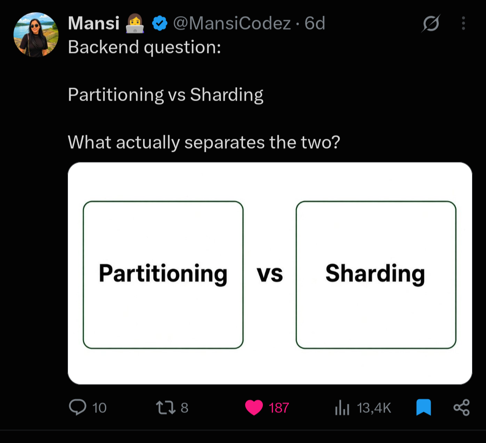
<br/>
<br/>
</center>

For a long time, I used sharding and partitioning as interchangebly concepts, almost like synonyms, even though _in my head_ sharding has ever been an __industry-crafted term__ that heavily implied scaled-out multi node architectures while partitioning was the more general concept above it. But for my surprise, many replies to this particular tweet were saying essentially this:

>  _"Partitioning splits data within a single server, while sharding distributes data accross multiple servers to scale horizontally."_ 

The same adage, expressed by different individuals, pointed to a more solid, ingrained or established definition that went straight under my radar this whole time! I was mesmerized... Maybe something changed while I was out, hahah? Maybe I didn't get the memo back then?

In a previous life, this would  immediately engage me on that famous [XCD cartoon](https://xkcd.com/386/):

<center>

<br/>
<br/>
</center>

But jumping on heated discussions for countless hours on a medium of limited expressiveness feel so dated and tiresome and, well, wasteful... Therefore, I decided to hit the respectable literature and products' documentations, so that I could challenge my own (mis-)understandings, fill in the gaps, and _maybe_ write an educational material in the process. 

_And for what's worth, a genuine and relevant doubt unfolded itself into a nice oportunity to review some crucial concepts in databases and distributed systems!_ 😄

<center>

<br/>
<br/>
</center>

<div class="custom-box">
<p>To cut to the chase, there's no really right or wrong side. The <i>"partitioning is within one node; sharding is across nodes"</i> definition is a <strong>useful convention</strong> adopted by some database products and communities, <strong>but it is not an universal definition,</strong> and it is definitely <strong>not how the broader database and distributed systems communities define partitioning and sharding.</strong> The terminology became <i>muddy</i> because different database traditions evolved their vocabulary independently. Alas, <i>a similar thing</i> happened with <a href src="">clustered vs. clustering indexes</a>! 😝</p>
</div>

<!-- **UPDATE [09-05-2026]**: while writing this post, I stumbled upon yet another post on other social media site mentioning aforementioned distinction between partitioning and sharding... Maybe this can be a timely blog post, after all? LOL

<center>
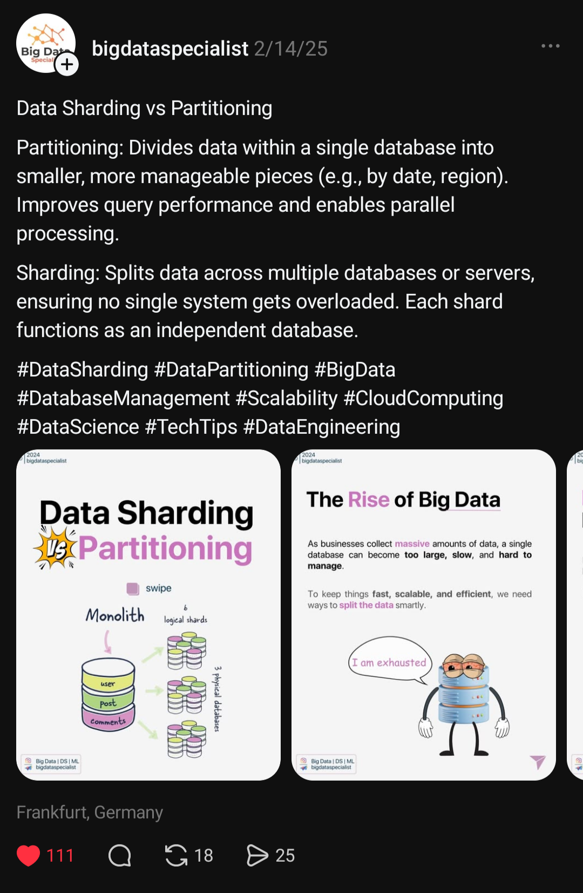
<br/>
<br/>
</center> -->


Besides any academic literature, this kind of intermingling among partition and sharding definitions can be seen on a sample of real world systems' terminologies listed in table below. We see 'partition' being used for both single node (e.g., PostgreSQL and Oracle) as well as multi node scenarios (e.g., Kafka and Cassandra), so the affirmation that partitions are only for single nodes just doesn't stand a closer look.

| System                  | Name                    |
| ------------------------| ----------------------- |
| Dynamo                  | partition               |
| Cassandra               | partition / token range |
| Kafka                   | partition               |
| Bigtable                | tablet                  |
| HBase                   | region                  |
| CockroachDB             | range                   |
| MongoDB                 | shard / chunk           |
| Elasticsearch           | shard                   |
| SolrCloud               | shard                   |
| PostgreSQL              | partition               |
| Oracle                  | partition               |
| Vitess                  | shard                   |
| Spanner                 | partition (CONFIRM)     | 
| TiDB                    | range                   |
| YugaByteDB              | tablet                  |
| DynamoDB                | shard                   |


<font color="red" bold>**TODO: SHOULD WE DEFINE PARALLEL DATABASES, DISTRIBUTED DATABASES, CLOUD SYSTEMS, NOSQL SYSTEMS AND RAID DISKS?**</font>

A shard is a partition, but not every partition is necessarily a shard.

For example, PostgreSQL table partitioning:
```
orders
  ├── orders_2024
  ├── orders_2025
  └── orders_2026
```
on one PostgreSQL instance is clearly partitioning, but we'd rarely call it sharding.

Conversely:
```
hash(customer_id)

0–999       → Node A
1000–1999   → Node B
2000–2999   → Node C
```
is both partitioning and sharding.

## Why, then, do people say "partitioning = one machine"?

Mostly because of SQL **database product terminology**, rather than distributed-systems theory. 

The clean “partitioning = single node, sharding = multiple nodes” distinction appears to have emerged from commercial RDBMS terminology on one side and web-scale operational practice on the other, not from distributed database theory.

Traditional relational DBMSs developed strong support for something explicitly called table partitioning: Oracle partitioned tables, PostgreSQL declarative partitioning, SQL Server partitioned tables, MySQL partitioning, etc.

So academically, partitioning was never inherently single-node.

These features often look like:

```
CREATE TABLE measurements (...)
PARTITION BY RANGE (timestamp);
```

The partitions remain logically part of one table and traditionally exist under one DBMS installation.

Meanwhile, in the 2000s, web companies faced a somewhat different problem:

"One database server can't hold or process all of our users. Let's split users among many database servers."

The term that became popular for that architecture was sharding.

For example:
```
             Application
                 │
         hash(user_id)
          /      |      \
         /       |       \
       DB1      DB2      DB3
      shard 1  shard 2  shard 3
```
This produced an extremely convenient practitioner distinction:

> Partitioning = split a table inside the database.
> Sharding = split the database across machines.

It's pedagogically convenient. It is also historically understandable.

But people eventually started treating the convention as though it were the formal definition.

It isn't.

Commercial relational systems then popularized partitioning as a product feature for subdividing one logical table into physical pieces under one DBMS. Oracle’s documentation is a particularly clear lineage: Oracle 10g describes partitioning as decomposing a large table or index into smaller manageable pieces called partitions; the feature is transparent to the application. PostgreSQL uses essentially the same product-level vocabulary today: “splitting what is logically one large table into smaller physical pieces.” https://docs.oracle.com/cd/B13789_01/server.101/b10743/partconc.htm

By the mid/late 2000s, web companies were using sharding specifically for distributing subsets of application data over multiple MySQL servers. Flickr is excellent primary evidence. Its engineering blog wrote in 2010: “Sharding (aka data partitioning) is how we scale Flickr’s datastore,” then immediately explained that instead of one large database, Flickr had many databases, each holding some of the data. That is almost a fossil record of the terminology transition: sharding was the operational term, while the authors explicitly regarded it as data partitioning. https://code.flickr.net/2010/02/08/ticket-servers-distributed-unique-primary-keys-on-the-cheap

The vocabulary then hardened through products such as MongoDB. MongoDB's documentation gives perhaps the archetypal modern practitioner definition:

“Sharding is a method for distributing data across multiple machines.”

It contrasts this with scaling a single server and describes each shard as containing a subset of the dataset. https://www.mongodb.com/docs/manual/sharding

Vitess is even more explicit and intellectually cleaner:

“Sharding is a method of horizontally partitioning a database to store data across two or more database servers.”

So Vitess does not treat partitioning and sharding as mutually exclusive. It defines sharding as distributed horizontal partitioning. https://vitess.io/docs/archive/14.0/reference/features/sharding

And Oracle provides what is probably the best evidence that the conceptual relationship is exactly the one we discussed earlier. Oracle's own Sharding documentation has a section literally titled “Sharding as Distributed Partitioning”, stating that sharding is based on horizontal partitioning of data across multiple independent physical databases. It further says that table partitions within a shard are the same kind of partitions used in a non-sharded Oracle database. https://docs.oracle.com/en/database/oracle/oracle-database/12.2/admin/sharding-physical-organization.html

So there was a sociotechnical reason for the distinction.

When an Oracle/PostgreSQL/MySQL DBA in roughly 2000 said:

“We partitioned the orders table.”

they typically meant a native DBMS feature:

```
Oracle instance

ORDERS
├── P_2001
├── P_2002
├── P_2003
└── P_2004
```

When a Flickr/LiveJournal-style architect several years later said:

“We sharded users.”

they meant something operationally very different:
```
Application
     |
     +-- users 0–999K    → MySQL A
     +-- users 1M–1.9M   → MySQL B
     +-- users 2M–2.9M   → MySQL C
```

Those two activities had radically different operational consequences, so having two words was useful.

The problem arose when the useful practitioner distinction became retroactively interpreted as a definition of partitioning itself.

And we can see even modern commercial material doing exactly that. Google Cloud currently has explanatory material saying, in effect, that partitioning keeps pieces on the same server whereas sharding places them on different servers. That is a perfectly usable introductory convention for application architects — but interestingly the same Google ecosystem also talks about geo-partitioning, distributed Spanner partitions, and automatic database sharding.

So even industry terminology isn't internally uniform.

I would therefore revise one part of the Venn diagram I generated for you earlier. Calling the bottom diagram “STRICT INDUSTRY” with disjoint sets was too strong. There is no industry-wide strict definition that makes them disjoint.

The historically defensible picture is instead:

```
FORMAL / GENERAL CONCEPT

            PARTITIONING
        ┌───────────────────┐
        │                   │
        │   ┌───────────┐   │
        │   │ SHARDING  │   │
        │   │           │   │
        │   │ horizontal│   │
        │   │ distributed│  │
        │   └───────────┘   │
        │                   │
        └───────────────────┘
```

while the common RDBMS practitioner convention is:

```
"partitioning"              "sharding"

one DBMS                    multiple DBMS nodes
──────────────              ───────────────────
table partitions            data shards
range/list/hash             range/hash/directory
DBMS-managed                often cluster/app-managed
scale-up/manageability      scale-out
```

Those are terminological buckets, not disjoint mathematical concepts.

And one lovely piece of evidence is Flickr itself:

> “Sharding (aka data partitioning)”

That is almost exactly the position you had arrived at independently: sharding emerged as the industry/web-scale name for a distributed form of something database theory already knew as partitioning.

There is therefore a fairly strong case that saying “partitioning means single node” without qualification is historically and technically misleading. A more precise statement is:

> “In some RDBMS/product discussions, partitioning conventionally means intra-database table partitioning, while sharding means horizontal partitioning across database instances.”

That preserves the useful industry distinction without rewriting several decades of distributed-database terminology.

## Distributed-systems literature makes the Twitter definition especially problematic

Consider systems such as Dynamo, Cassandra, Bigtable, Spanner, CockroachDB, etc.

Their literature routinely discusses partitioning data across machines.

Dynamo is a particularly clean example. Its famous consistent-hashing ring divides the key space into partitions and assigns those partitions to physical nodes:

```
                key space
                   ○
             ╱           ╲
           P1             P2
          Node A         Node B
          │                 │
           P6             P3
             ╲           ╱
               P5 ─── P4
                 Node C
```

Calling this "not partitioning because it crosses machines" would be bizarre in distributed-systems terminology. Distribution is precisely one of the major reasons we study partitioning.

The same applies to concepts such as:

hash partitioning,
range partitioning,
consistent hashing,
partition placement,
partition migration,
repartitioning,
partition skew,
partition tolerance,
partition-aware query execution.

None of these inherently means "inside one machine."

This is why your reading of distributed-database books gave you a different intuition from the Twitter replies.


## Fragmentation, Allocation and Replication
<center>

<br/>
<br/>
</center>

The academic distributed/database literature conceptually separate the concepts of _**Fragmentation, Allocation, and Replication**_ (or should we say _"The Good, The Bad and The Ugly"_?) as three related but orthogonal axis of classification (see [Figure 1](#figure-1)), with the following definitions:

<div class="custom-box">
  <p><strong>- Fragmentation/Partitioning</strong>: the tecnhiques for breaking a database <strong>relation (table)</strong> into logical units, called <strong>fragments (partitions)</strong>, and <i>maybe</i> distribute them among <strong>sites (nodes)</strong> or RAID disk arrays, for example;</p>
  <p><strong>- Allocation (Placement):</strong> the process of mapping that specifies, <i>for each fragment</i>, the sites at which it is stored;</p>
  <p><strong>- Replication:</strong> the techniques that allow the fragments and its copies to be distributed in one or more sites to improve availability and performance;</p>
</div>

<center id="figure-1">
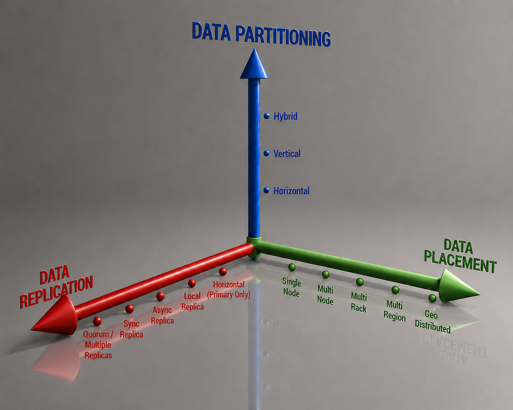
<br/>
<strong>Figure 1 - Three axis of classification</strong>
<br/>
</center>

<font color="red" bold>
**TODO: DISCLAIMER ABOUT THE VERNACULAR IN DISTRIBUTED DATABASES? I.e., sites, fragments, etc?**
</font>

### 1. Partitioning

Ramakrishnan and Gehrke's [Database Management Systems](https://pages.cs.wisc.edu/~dbbook/openAccess/thirdEdition/supporting_material.htm) (3rd Edition, 2003) defines fragmentation (i.e., partitioning) as:

> _"**Fragmentation** consists of breaking a relation into smaller relations or **fragments** and storing the fragments (instead of the relation itself), possibly at different sites. In **horizontal fragmentation**, each fragment consists of a subset of rows of the original relation. In **vertical fragmentation**, each fragment consists of a subset of columns of the original relation."_

So, this definition can be summarised in a short paragraph (or tweet!) as:

> _Partitioning means dividing a dataset into disjoint subsets according to some rule._


_The partitions (fragments) are defined as the logical unit of division and distribution in a database_, so that a relation $$R$$ is split into (_usually_) disjoints $$P_i$$ partitions  over one or more attributes (called _partitioning attributes, partitioning keys or shard keys_) of $$R$$, such that:

$$R = P_1 \cup P_2 \cup P_3 \cup ... \cup P_n $$

But it's worth pointing that this definition doesn't conditionate partitioning of data to its  placement, be it local or distributed among nodes. Those partitions $$P_{i}$$, for $$i = \{1,.., n\}$$ could either reside on a single node,

<center>
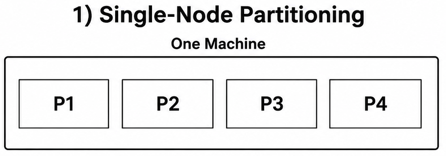
<br/>
<br/>
</center>

or be distributed among various nodes,

<center>
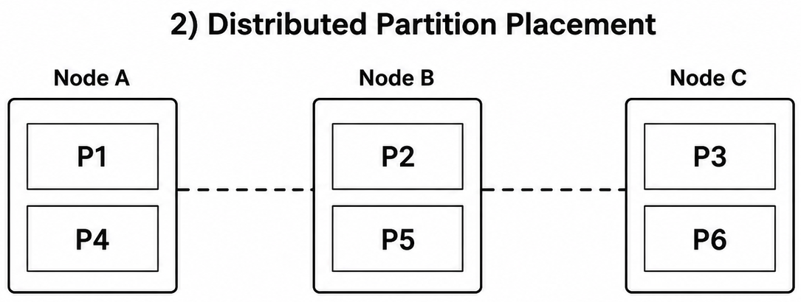
<br/>
<br/>
</center>

or even be a combination of single and multi node, but, in any case, they are still *partitions*.

#### 1.1. Partitioning Strategies

As seen in Ramakrishnan and Gehrke's definition, data partitioning is further divided into horizontal and vertical partitioning, and this is also defined by Özsu and Valduriez's [Principles of Distributed Database Systems](https://cs.uwaterloo.ca/~ddbook/) (4th ed, 2020):

> _"Relational tables can be partitioned either horizontally or vertically. The basis of horizontal fragmentation is the select operator where the selection predicates determine the fragmentation, while vertical fragmentation is performed by means of the project operator. The fragmentation may, of course, be nested. If the nestings are of different types, one gets hybrid fragmentation."_


##### Horizontal Partitioning

Horizontal Partitioning splits the relation $$R$$ into (usually) _disjoints_ subsets of the tuples of the original relation, specified by a condition $$C$$. The horizontal partitioning can be expressed as the relational algebra's SELECT ($$\sigma$$)[^select-sql] operation:
em
[^select-sql]: The SELECT operation should not to be confused with the SQL's SELECT clause;

$$\sigma_{C}(R)$$

Condition $$C$$ is a predicate often composed a single one attribute -- with the form $$R.\text{attr} \mathrel{\mathbf{op}} \text{value}$$, where $$R.attr$$ is an attribute of relation $$R$$, **op** is a conditional operator (e.g., =, $$<, \ge$$), and _value_ is a literal.

Suppose we have the following _PROJ_ table and apply conditions $$C_{1} = BUDGET < 250000$$ and $$C_{2} = BUDGET \ge 250000 $$, this will produce two horizontal partitionings as below:

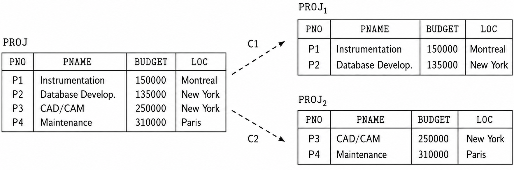

Elmasri and Navathe define an interesting properties of horizontal partitioning:

> _"A set of horizontal fragments whose conditions $$C_1, C_2, … , C_n$$ include all the tuples in R—that is, every tuple in R satisfies ($$C_1$$ OR $$C_2$$ OR … OR $$C_n$$)—is called a **complete horizontal fragmentation** of R. In many cases a complete horizontal fragmentation is also **disjoint**; that is, no tuple in $$R$$ satisfies ($$C_i$$ AND $$C_j$$) for any $$i \neq j$$."_

And to reconstruct the relation R from a **complete horizontal fragmentation**, it is necessary to apply the UNION operation to the partitions.

It's also important to point out that depending on the $$C_i$$ conditions of the horizontal partitioning, there may result in an uneven data distribution among the partitions (**data skew**), as illustrated by the image below where we split the horizontal fragments by the Dno column. This can potentially created **hot spots** and performance bootlenecks, with some partitions overloaded while others are mostly idle. 

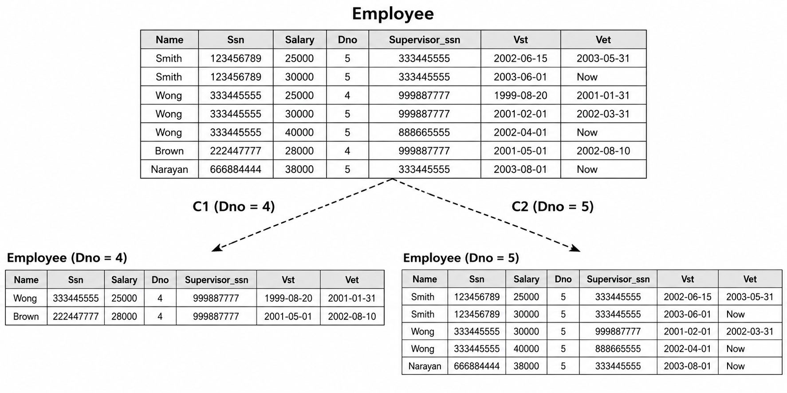

Both Silberschatz et al and Özsu and Valduriez mention that horizontal partition is widely used for parallel and distributed database systems because of its inherent opportunities for both  interquery and intraquery parallelism[^intra-inter-query].

[^intra-inter-query]: While interquery allows the parallel execution of a number of queries on various nodes, intraquery allows the parallel execution of a single query by breaking it up on subqueries and executing on various partitions in parallel.
##### Horizontal Partitioning Strategies

Horizontal partitioning can be further divided into different schemes to split the rows into disjoints subgroups:

1. Hash Partitioning
2. Range Partitioning
3. Round-Robin Partitioning

```
Partitioning strategy

   ├── Range
   ├── Hash
   ├── List
   ├── Consistent hash
   ├── Directory
   └── Composite
```

##### Primary and Secondary Horizontal Partitioning

A **primary horizontal partitioning** is a partition defined by predicates on root tables (source tables): tables that exist as independents entities, without any Foreign Key (FK) pointing to it, like, for example, CUSTOMER table in the example below. This table can be partitioned by their range IDs, for example. 

On the other hand, **derived horizontal partitioning** is the partitioning of a relation that results from predicates being defined by another relation (that is, the table depends on one or more other tables to exist and have uniqueness). Tables like ORDERS and INVENTORY are examples of such tables, so that we can 

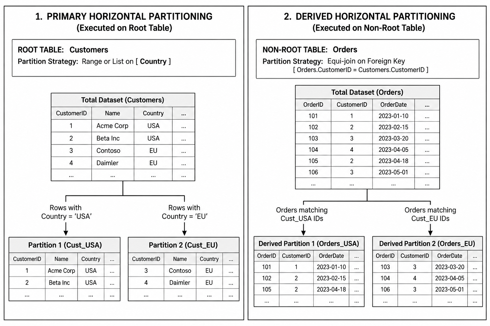


##### Vertical Partitioning

Vertical partitioning splits a relation $$R$$ into partitions each containing a subset of $$R$$'s attributes (columns). In other words, it divides a relation "vertically" by columns. This particular kind of data partitioning was successfully implemented by column stores DBMSs like MonetDB/X100, Vertica, Snowflake and DuckDB, for example, as well as open data formats and OLAP query engines.

Vertical Partitioning can be expressed as the relational algebra's PROJECT ($$\pi$$) operation:

$$\pi_{L_i}(R)$$

where $${L_i}$$ is the list of attributes (columns) of $$R$$, for $$i = 1,..., N$$, where $$N$$ is the number of attributes of relation $$R$$.

Supose that our PROJ table is split by two lists of attributes, $$L_{1} = \{PNO, BUDGET\}$$ and $$L_{2} = \{PNO, PNAME, LOC\}$$

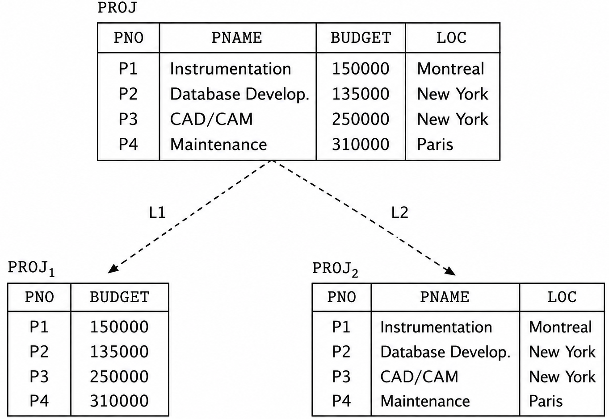

As we can see in the example above, PNO, the Primary Key (PK) of PROJ table is duplicated on the two fragments -- $$PROJ_{1}$$ and $$PROJ_{2}$$. This is not a coincidence, but a concious database design decision so that we are able to reconstruct the original relation $$R$$ from its vertical fragments by using an OUTER UNION operation. In other words, our database design has a _lossless-join property_.

A vertical partitioning is said to be a _**lossless-join decomposition**_ if it's always possible to reconstruct the  original relation $$R$$ from its vertical fragments $$L_1, L_2, ... L_n$$. This is more succintly expressed in relational algebra as: 

$$ R = \pi_{L_{1}}(R) \bowtie \pi_{L_{2}}(R)$$

That is, the natural join of the projection results _exactly_ in the original relation $$R$$. Conversely, if the same natural join computation results in a **superset** of the original relation  then the decomposition is said to be lossy. This can be express succintly in the relational algebra as:

$$R \subset \pi_{L_{1}}(R) \bowtie \pi_{L_{2}}(R)$$

The Figure 2.2 of Georgiev[^georgiev-paper] shows examples of a lossy (a) and lossless (b) decomposition properties.

[^georgiev-paper]: Nikolay Georgiev, "A Web-Based Environment For Learning Normalization of Relational Database Schemata", Master’s Thesis in Computing Science, 2008.

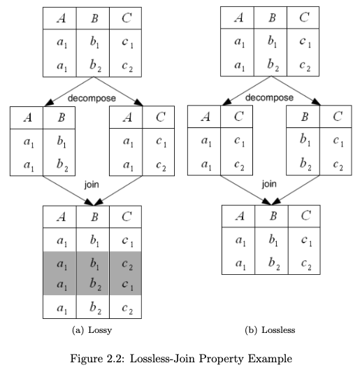

Finally, Ramakrishnan and Gehrke state the following about  vertical partitioning:

> _"To ensure that a vertical fragmentation is lossless-join, systems often assign a **unique tuple id** to each tuple in the original relation, as shown in Figure 22.4, and attach this id to the projection of the tuple in each fragment. If we think of the original relation as containing an additional tuple-id field that is a key, this field is added to each vertical fragment. Such a decomposition is guaranteed to be lossless-join."_

As described by Elsmari and Navathe, a set of vertical partitions whose projection lists $$L_1, L_2, ... , L_n$$ include all the attributes in $$R$$ but share only the primary key attribute of R is called a **complete vertical fragmentation** of $$R$$. Therefore, in this case, the projection lists satify the following conditions:
1. $$L_1 \cup L_2 \cup ... \cup L_n = ATTRS(R)$$;
2. $$L_i \cup L_j = PK(R)$$, _for any $$i \neq j$$, where ATTRS(R) is the set of attributes of R and PK(R) is the primary key of R_;

And to reconstruct the relation R from a complete vertical fragmentation, we apply the OUTER UNION operation to the vertical fragments. Furthermore, for the $$R_1, R_2, ... R_n$$ vertical fragments of $R$, we have that $$R_1 \cap R_2 \cap ... \cap R_n = A$$, where $$A$$ is an unique key attribute of $$R$$ 

##### Hybrid Partitioning

A **hybrid partitioning** is the combination of horizontal partitioning and vertical partitioning, also called **mixed partitioning**. In this kind of partitioning, a fragment of a relation R can be specified by a SELECT-PROJECT combination of operations $$\pi_L(\sigma_C(R))$$, and the original relation $$R$$ can be reconstructed by applying UNION **and** OUTER UNION (or OUTER JOIN) operations in the appropriate order.

In the Employee table example, if we partition by Department Number (Dno) and Social Security Number (SSN), there are four resulting partitions:

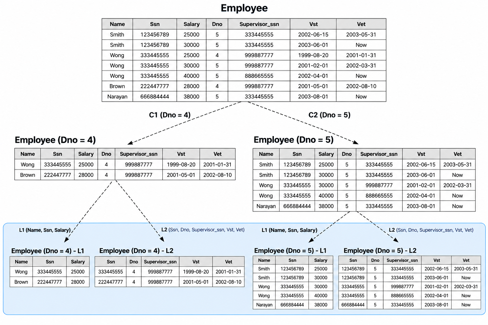


### 2. Allocation

### 3. Replication


## So what is sharding after all?

The authors cited address _sharding_ in their works, but with slightly different nuances among them. **For Özsu and Valduriez, Elmasri and Navathe, Ramakrishnan and Gehrke, and Silberschatz et al, _sharding is a synonym for horizontal partitioning_**, and the term is specially widespread in the context of NoSQL databases, Big Data, cloud computing systems.

But  Silberschatz et al also points that in sharding architectures each node can have a traditional centralized, _maybe independent_, database instance (like standalone full MySQL DB instances, for example) and the queries would be routed by a middleware, as the image below:

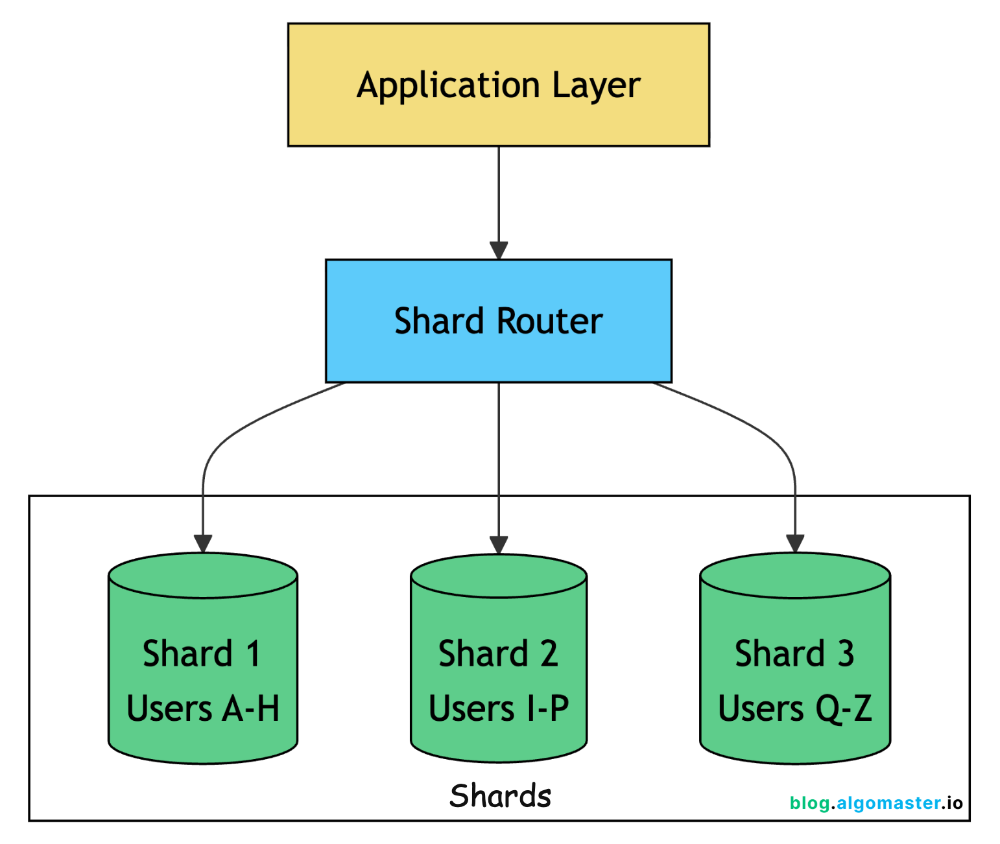
 
In this architectural model, the sharding query requests can be executed by the database, or a  middleware, or even application code. Each shard is an independent and standalone database that replicates all the database schema, but has only $$\frac{1}{N}$$ of the data, in cluster of size N.

Besides that, Silberschatz acknowledges that partitions can reside on a single node, as quoted below:

> _"We also note that several database vendors use the term partitioning to denote the partitioning of tuples of a relation $$r$$ into multiple physical relations $$r_1, r_2 ,…, r_n$$, where all the physical relations $$r_i$$ are stored in a single node. The relation $$r$$ is not stored, but treated as a view defined by the query $$r_1 \cup r_2 \cup … \cup r_n$$. Such intra-node partitioning of a relation is typically used to ensure that frequently accessed tuples are stored separately from infrequently accessed tuples and is different from horizontal partitioning across nodes."_

Kleppmann and Riccomini's [*Designing Data-Intensive Applications*](https://www.oreilly.com/library/view/designing-data-intensive-applications/9781098119058/) (2nd Edition, 2026) devotes none less than a whole chapter to sharding. The "Sharding and Partitioning" box in Chapter 7 states it clearly:

> _"**What we call a shard in this chapter has many names depending on which software you're using.** It's called a partition in Kafka, a range in CockroachDB, a region in HBase and TiDB, a vBucket in Couchbase, a vnode in Riak, a token-range in Cassandra, and a tablet in Bigtable, YugaByteDB, and ScyllaDB, to name just a few._
> _Some databases treat partitions and shards as two distinct concepts. For example, **in PostgreSQL, partitioning is a way of splitting a large table into several files that are stored on the same machine** (which has several advantages, such as making it very fast to delete an entire partition), whereas sharding splits a dataset accross multiple machines[1,2]. **In many other systems, partitioning is just another word for sharding.**"_

Again, we have yet another distinguished book stating clearly that: _A)_ there is no clear separation between the concepts of sharding and partition either on industry or academia, up to the point that two terms are often used as synonyms (phew! 😅) and _B)_ what is usually known as a partition can refer to intra-node only partition too! By the way, this kind of intra-node partitioning acknowledged by both Klepmann and Silberschatz is probably from where the _"partitioning within a single node"_ adage came from.

## Takeaway

A more concise definition of _sharding_ could be:

> **Sharding is horizontal partitioning of data distributed across different nodes.**

And based on what we have seen so far, we may establish the following relation:

> **A shard is a partition, but not every partition is necessarily a shard.**

This derives directly from the fact that there are partitions on a single node, for example, while sharding usually involves horizontal partitioning + allocation among various nodes.

Finally, a key take away relationship among all of these concepts exposed so far would be:

$$Sharding \subseteq Horizontal Partitioning \subseteq Partitioning$$

Or as a cool cheat sheet:

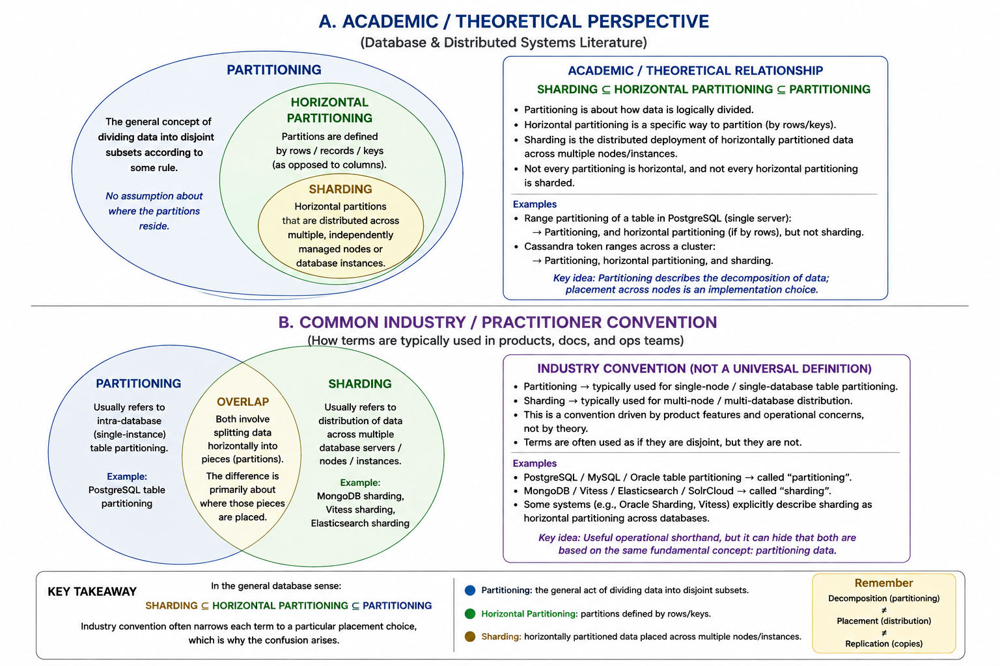
