<center>
<div style="display: flex; justify-content: center; align-items: center; gap: 20px; flex-wrap: wrap;">

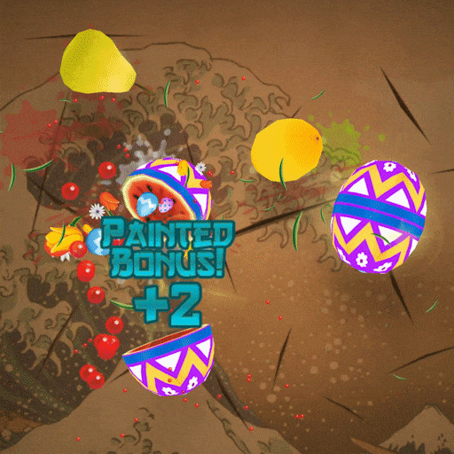
</div>
<br/>
<br/>
</center>

As I slowly, _and reluctantly_, try to make a comeback to microblogging sites after many years out, I stumbled across the following tweet in my very first days there:

<center>
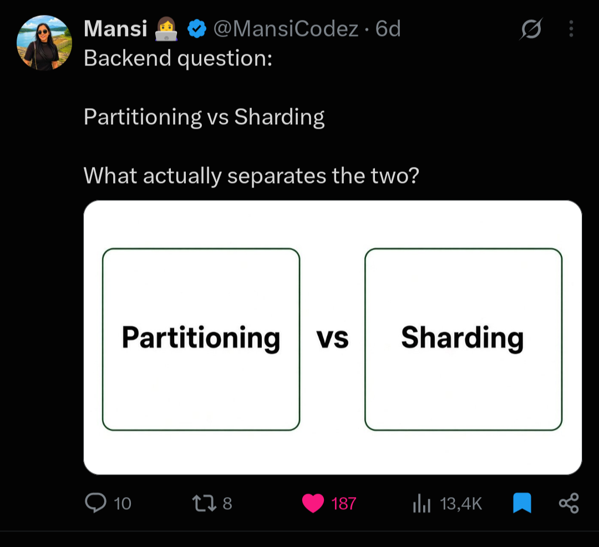
<br/>
<br/>
</center>

For a long time, I used _sharding_ and _partitioning_ as interchangeable concepts, almost like synonyms, even though _in my head_ sharding has always been an __industry-crafted term__ that heavily implied scaled-out multi-node architectures while partitioning was the more general concept above it. But to my surprise, many replies to this particular tweet were saying essentially this:

>  _"Partitioning splits data within a single server, while sharding distributes data accross multiple servers to scale horizontally."_ 

The same adage, expressed by different individuals, indicated a more solid, ingrained or established definition that went straight under my radar this whole time! I was mesmerized... Maybe something changed while I was out, hahah? Maybe I didn't get the memo back then?

In a previous life, this small discordance would immediately engage me on a real-life version of that famous [XKCD cartoon](https://xkcd.com/386/):

<center>

<br/>
<br/>
</center>

But jumping headfirst into heated discussions for countless hours in a medium of limited expressiveness feels so dated, tiresome and, well, wasteful... Therefore, I decided to hit the respectable literature and products' documentations, so that I could challenge my own (mis-)understandings, fill in the gaps, and _maybe_ write an educational material in the process. 

_And for what's worth, a genuine and relevant doubt unfolded itself into a nice oportunity to review some crucial concepts in databases and distributed systems!_ 😄

<center>

<br/>
<br/>
</center>

<div class="custom-box">
<p>To cut to the chase, there's no really right or wrong side. The <i>"partitioning is within one node; sharding is across nodes"</i> definition is a <strong>useful convention</strong> adopted by some database products and communities, <strong>but it is not an universal definition,</strong> and it is definitely <strong>not how the broader distributed (database) systems' communities define partitioning and sharding.</strong> The terminology became <i>muddy</i> because different database traditions evolved their vocabulary independently. Alas, <i>a similar thing</i> happened with <a href="">clustered vs. clustering indexes</a>! 😝</p>
</div>

<!-- **UPDATE [09-05-2026]**: while wrapping up this post, I stumbled upon yet another post mentioning the aforementioned distinction between partitioning and sharding... Maybe this could be a timely blog post, after all? 😏

<center>
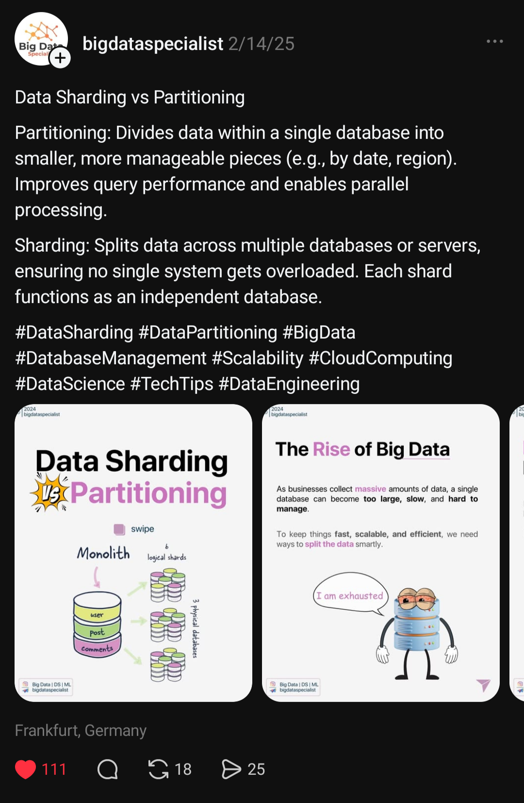
<br/>
<br/>
</center> -->

To kickstart the discussion, let's see how this kind of intermingling between partitioning and sharding definitions can be witnessed _nowadays_ on many real-world systems' terminologies. In the sample listing of [Table 1](#table-1), _"partition"_ is being used to describe both single-node systems (e.g. PostgreSQL) and multi-node systems (e.g. DynamoDB), with a few other synonym terms (e.g., tablet and region) thrown into the mix! Therefore, **the assertion that partitions are only for single nodes just doesn't stand up to a closer look.** :smiling_face_with_tear:

| System                                                                                                      | Name                    |
| ------------------------------------------------------------------------------------------------------------| ----------------------- |
| [Dynamo](https://www.allthingsdistributed.com/files/amazon-dynamo-sosp2007.pdf)                             | partition               |
| [Cassandra](https://cassandra.apache.org/_/cassandra-basics.html)                                           | partition / token range |
| [Kafka](https://kafka.apache.org/intro/)                                                                    | partition               |
| [Bigtable](https://docs.cloud.google.com/bigtable/docs/overview)                                            | tablet                  |
| [HBase](https://hbase.apache.org/book.html)                                                                 | region                  |
| [CockroachDB](https://www.cockroachlabs.com/docs/stable/architecture/distribution-layer)                   | range                   |
| [MongoDB](https://www.mongodb.com/docs/manual/core/sharding-data-partitioning/)                              | shard / chunk           |
| [Elasticsearch](https://www.elastic.co/docs/deploy-manage/distributed-architecture/clusters-nodes-shards)   | shard                   |
| [SolrCloud](https://solr.apache.org/guide/solr/latest/deployment-guide/solrcloud-shards-indexing.html)      | shard                   |
| [PostgreSQL](https://www.postgresql.org/docs/current/ddl-partitioning.html)                                 | partition               |
| [Oracle](https://docs.oracle.com/en/database/oracle/oracle-database/26/vldbg/partition-admin.html)          | partition               |
| [Vitess](https://vitess.io/docs/25.0/concepts/shard/)                                                       | shard                   |
| [Spanner](https://docs.cloud.google.com/spanner/docs/schema-design)                                         | split                   |
| [TiDB](https://docs.pingcap.com/tidb/stable/tikv-overview/)                                                 | region                  |
| [YugaByteDB](https://docs.yugabyte.com/stable/architecture/docdb-sharding/)                                 | tablet                  |
| [DynamoDB](https://docs.aws.amazon.com/amazondynamodb/latest/developerguide/HowItWorks.Partitions.html)     | partition               |
| [Apache Iceberg](https://iceberg.apache.org/docs/latest/partitioning/)                                      | partition               |
| [H-Store/VoltDB](https://docs.voltdb.com/UsingVoltDB/DesignPartition.php)[^voltdb]                          | partition               |

<a id="table-1"></a>

**Table 1 - Real world systems' terminologies**

[^voltdb]: The commercial database is currently known as Volt Active Data.


## Then why do people say "partitioning = one machine"?

_Probably_ because of **the commercial database vendors' terminology and the dot-com era's web companies**. The _"partitioning = single node, sharding = multiple nodes"_ distinction _seems_ to have emerged from these two different, but related, arenas, as we should see shortly.

#### The commercial DBMS' prism lens

On one side, we had commercial DBMSs popularizing and strongly supporting, to this day, **table partitioning** as a product feature for subdividing one logical table into physical pieces under a single database installation. [Oracle 10g](https://docs.oracle.com/cd/B13789_01/server.101/b10743/partconc.htm) describes partitioning as decomposing a large table or index into smaller pieces called partitions. [PostgreSQL](https://www.postgresql.org/docs/18/ddl-partitioning.html) uses essentially the same product-level vocabulary: _"splitting what is logically one large table into smaller physical pieces."_ We also had other instances of this trend in products like [SQL Server](https://learn.microsoft.com/en-us/sql/relational-databases/partitions/partitioned-tables-and-indexes), [MySQL](https://dev.mysql.com/doc/refman/9.7/en/partitioning.html), and [Db2](https://www.ibm.com/docs/en/db2/11.5.x?topic=tables-table-partitioning), for example. 

So, when a DBA in the 2000s said that _"we partitioned the orders table"_, they usually meant a native DBMS feature like this:

[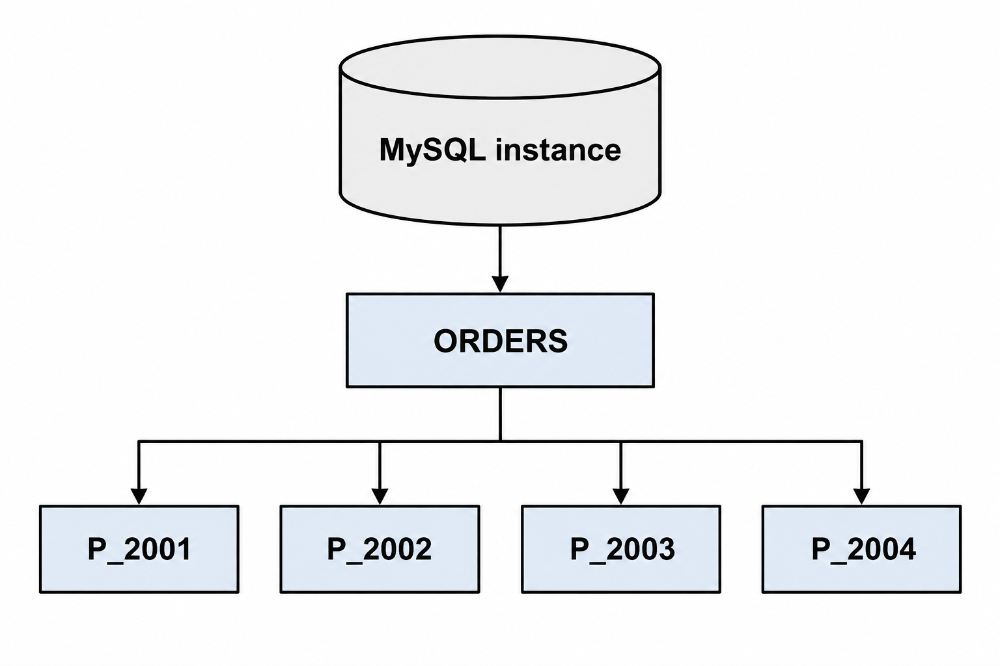](/images/posts/partitioning_vs_sharding/table-partitioning.png)

These features often look like:

```sql
CREATE TABLE orders (...)
PARTITION BY RANGE (timestamp);
```

#### The web-scale systems' prism lens

On the other side, also during the 2000s, web companies faced a somewhat different problem due to the exponential growth of the web: a single database server couldn't support all their users' data and load, so web companies started using the term _sharding_ specifically for describing the distribution of subsets of the application's data over multiple database servers. Sharding was the operational term for companies like eBay, Yahoo!, Facebook, among others. An old engineering post by [Flickr](https://code.flickr.net/2010/02/08/ticket-servers-distributed-unique-primary-keys-on-the-cheap) summarises how many companies operated back in the day:

> _"**Sharding** (aka **data partioning**) is how we scale Flickr’s datastore. Instead of storing all our data on one really big database, we have lots of databases, each with some of the data, and spread the load between them."_

Back in the day, when an eBay/Flickr/Facebook/Google engineer said that _"we sharded users”_, they usually meant something like:

[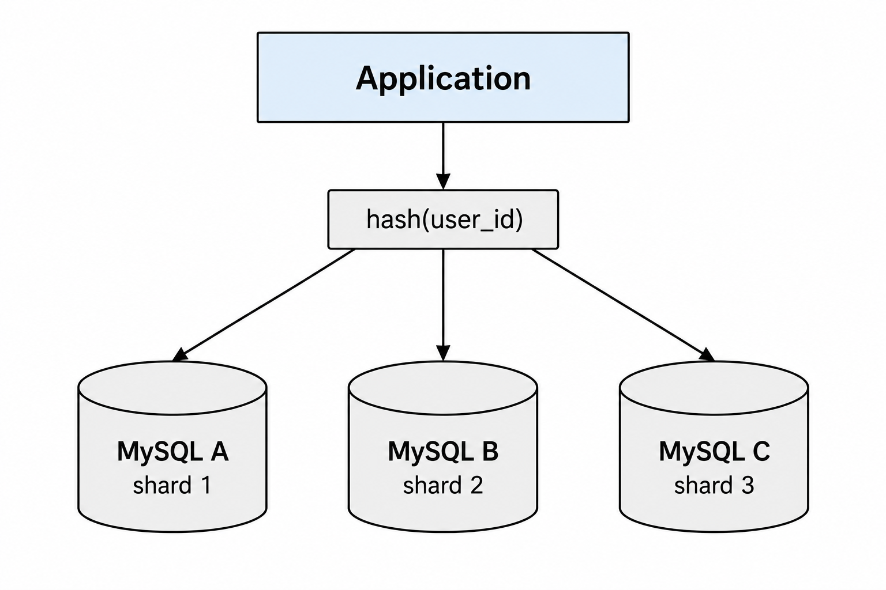](/images/posts/partitioning_vs_sharding/sharding-architecture.png)

And later, during the 2010s, the "sharding" term solidified through the success of NoSQL systems such as MongoDB and Riak, for example. [MongoDB documentation](https://www.mongodb.com/docs/manual/sharding) states that _"Sharding is a method for distributing data across multiple machines."_ 

All of this produced an extremely convenient **practitioner** distinction:

> Partitioning = split a table inside the database.
> Sharding = split the database across machines.

There was a sociotechnical reason for the distinction: those two activities had radically different operational implications and consequences, so having two words was useful. The distinction is pedagogically convenient and historically understandable, but people eventually started treating the convention as if it were the formal definition. That is, the problem arose when the useful practitioner distinction became retroactively interpreted as a definition of partitioning itself, something that many decades of study and research on databases never supported.

Nevertheless, there are examples in the industry that acknowledge the relation between partitioning and sharding. [Vitess documentation](https://vitess.io/docs/archive/14.0/reference/features/sharding) is more explicit and intellectually cleaner, as it does not treat partitioning and sharding as mutually exclusive:

> _"**Sharding** is a method of **horizontally partitioning** a database to store data across two or more database servers."_

And [Oracle's sharding documentation](https://docs.oracle.com/en/database/oracle/oracle-database/12.2/admin/sharding-physical-organization.html) has a section literally titled _"Sharding as Distributed Partitioning"_, showing that sharding is based on horizontal partitioning of data across multiple independent physical databases. It further says that table partitions within a shard are the same kind of partitions used in a non-sharded Oracle database.

But things are far from being settled. Google Cloud currently has explanatory material saying that partitioning keeps pieces on the same server whereas sharding places them on different servers. Its own [explainer on data sharding](https://cloud.google.com/discover/what-is-database-sharding) draws the line almost as cleanly as the tweet that started all this:

> _"**Sharding is a specific type of horizontal partitioning** where the data pieces are distributed across completely different servers... Partitioning involves splitting a large table into smaller, more manageable pieces (like splitting a log table by month) but keeping them on the same server instance."_

But a few paragraphs further down **the very same page**, it describes Spanner — a "distributed SQL database" — as offering _"a 'no-sharding' experience"_ that _"automatically shards data and balances load across regions,"_ and credits Bigtable's tablet splitting as "automatic sharding" too. And the same Google ecosystem also talks about [geo-partitioning](https://cloud.google.com/spanner/docs/geo-partitioning), which _"lets you further segment and store rows in your database table across different instance configurations,"_ and about [distributed Spanner instance partitions](https://cloud.google.com/spanner/docs/create-manage-partitions), which are explicitly regional or multi-region constructs, each with their own compute capacity, spanning multiple servers by design. So even industry terminology isn't internally uniform — sometimes not even within the same web page!

Therefore, saying _"partitioning means single node"_ without qualification is historically and technically misleading. A more precise statement is:

> _"In some RDBMS discussions, partitioning conventionally means intra-database table partitioning, while sharding means horizontal partitioning across database instances."_

And even though partitioning was never inherently single-node in the literature, Silberschatz, Korth & Sudarshan[[3]](#ref-silberschatz2020) acknowledge that partitions may have such a narrower meaning:

> _"We also note that several database vendors use the term partitioning to denote the partitioning of tuples of a relation $$r$$ into multiple physical relations $$r_1, r_2 ,…, r_n$$, where all the physical relations $$r_i$$ are stored in a single node. The relation $$r$$ is not stored, but treated as a view defined by the query $$r_1 \cup r_2 \cup … \cup r_n$$. Such intra-node partitioning of a relation is typically used to ensure that frequently accessed tuples are stored separately from infrequently accessed tuples and is different from horizontal partitioning across nodes."_

Kleppmann and Riccomini[[4]](#ref-kleppmann2026), who devote no less than a whole chapter to sharding, also explain the nonconformity of the nomenclature surrounding sharding and partition:

> _"**What we call a shard in this chapter has many names depending on which software you're using.** It's called a partition in Kafka, a range in CockroachDB, a region in HBase and TiDB, a vBucket in Couchbase, a vnode in Riak, a token-range in Cassandra, and a tablet in Bigtable, YugaByteDB, and ScyllaDB, to name just a few._
> _Some databases treat partitions and shards as two distinct concepts. For example, **in PostgreSQL, partitioning is a way of splitting a large table into several files that are stored on the same machine** (which has several advantages, such as making it very fast to delete an entire partition), whereas sharding splits a dataset accross multiple machines[1,2]. **In many other systems, partitioning is just another word for sharding.**"_

So far, we have two reputable sources stating that:

- _a)_ there is no clear separation between the concepts of partitioning and sharding, either in industry or academia, up to the point that the two terms are often used as synonyms (_phew!_ 😅);
- _b)_ what is usually known as a partition can also mean something confined to a single node!

### How has academia treated these concepts?

To really understand how academia has dealt with these concepts for decades, we should focus on their vernacular and their assumptions first. It may even come as a surprise to newcomers that what the practitioners usually call _"partitioning"_ is frequently referred to by respectable sources in the literature as _"fragmentation"_. And the terminology mismatch doesn't stop there, as we have words like _"sites"_ for denoting nodes or computers, for example. 

In addition to that, it was already mentioned that classical and modern database literature doesn't restrict the applicability of data partitioning to an intra-node setup. Also, data partitioning can be applied to either parallel or distributed database systems (and arrays of disks too!). As explained by Özsu and Valduriez[[2]](#ref-ozsu2020), the main reasons and objectives for fragmentation in distributed versus parallel databases are slightly different. For example, data localization is not that much of a concern in parallel DBMSs since the communication cost among nodes is much less than in geo-distributed DBMSs.

## Fragmentation, Allocation and Replication
<center>

<br/>
<br/>
</center>

The academic distributed/database literature cleanly separates the concepts of _**Fragmentation, Allocation, and Replication**_ (or should we say [_"The Good, The Bad and The Ugly"_](https://en.wikipedia.org/wiki/The_Good,_the_Bad_and_the_Ugly)?) as three related but orthogonal axes of classification (see [Figure 1](#figure-1)), with the following definitions:

<div class="custom-box">
  <p><strong>- Fragmentation/Partitioning</strong>: the techniques for breaking a database <strong>relation (table)</strong> into logical units, called <strong>fragments (partitions)</strong>, and <i>maybe</i> distributing them among <strong>sites (nodes)</strong> or RAID disk arrays, for example;</p>
  <p><strong>- Allocation (Placement):</strong> the process that maps, <i>for each fragment</i>, the sites at which it is stored;</p>
  <p><strong>- Replication:</strong> the techniques that allow the fragments and its copies to be distributed in one or more sites to improve availability and performance;</p>
</div>

<a id="figure-1"></a>

[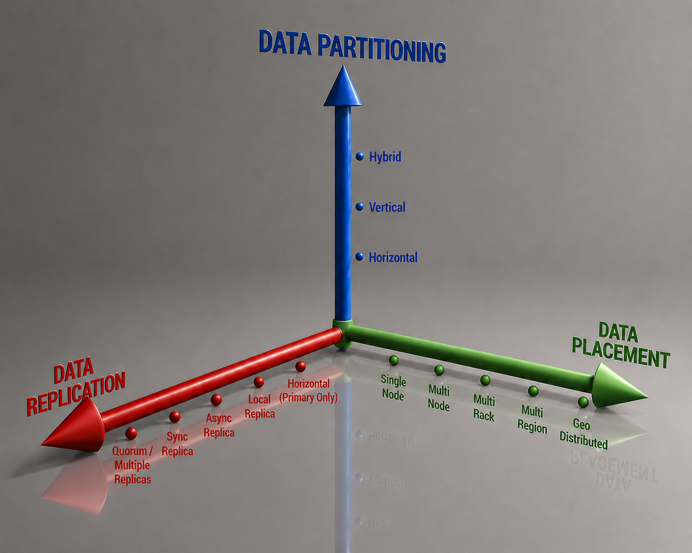](/images/posts/partitioning_vs_sharding/three-axis.png)

**Figure 1 - Three axes of classification**

### 1. Partitioning

Ramakrishnan and Gehrke[[1]](#ref-ramakrishnan2003) define fragmentation (i.e., partitioning) as:

> _"**Fragmentation** consists of breaking a relation into smaller relations or **fragments** and storing the fragments (instead of the relation itself), possibly at different sites. In **horizontal fragmentation**, each fragment consists of a subset of rows of the original relation. In **vertical fragmentation**, each fragment consists of a subset of columns of the original relation."_

So, this definition can be summarised in a short paragraph (or tweet!) as:

> _Partitioning means dividing a dataset into disjoint subsets according to some rule._


_The partitions (fragments) are defined as the logical unit of division and distribution in a database_, so that a relation $$R$$ is split into (_usually_) disjoint $$P_i$$ partitions over one or more attributes (called _partitioning attributes, partitioning keys or shard keys_) of $$R$$, such that:

$$R = P_1 \cup P_2 \cup P_3 \cup ... \cup P_n $$

This definition doesn't conditionate partitioning of data to its  placement, be it local or distributed among nodes. Those partitions $$P_{i}$$, for $$i = \{1,.., n\}$$ could either reside on a single node,

[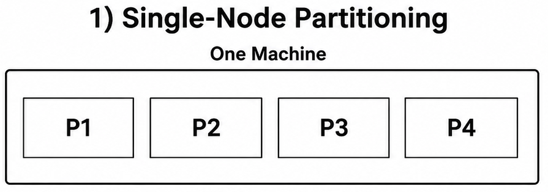](/images/posts/partitioning_vs_sharding/single-node-partition.png)

or be distributed among various nodes,

[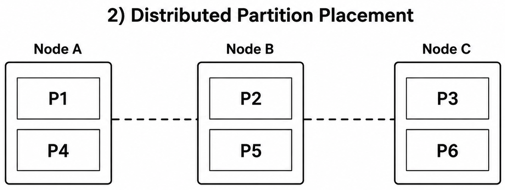](/images/posts/partitioning_vs_sharding/multi-node-partition.png)

or even be a combination of single and multi-node, but, in any case, they are still *partitions*.

#### 1.1. Partitioning Strategies

As seen in Ramakrishnan and Gehrke's definition, data partitioning is further divided into horizontal and vertical partitioning, and this is also defined by Özsu and Valduriez[[2]](#ref-ozsu2020):

> _"Relational tables can be partitioned either horizontally or vertically. The basis of horizontal fragmentation is the select operator where the selection predicates determine the fragmentation, while vertical fragmentation is performed by means of the project operator. The fragmentation may, of course, be nested. If the nestings are of different types, one gets hybrid fragmentation."_

Regardless of the partitioning strategy applied, the fragmentation should guarantee that the database doesn't undergo semantic changes during the process and ensure the reconstructibility property, that is, still be able to recover the original relation $$R$$ from its fragments. Although not always present, it is usually desirable for the fragmentation technique to have a set of properties during decomposition of the tuples among partitions, as listed below:

- Completeness: for any tuple $$t$$ of a relation $$R$$, $$t$$ will be in at least one partition, that is, no information is lost. This is based on the selection and projection predicates chosen;
- Reconstructibility: it should be possible to reconstruct the original relation $$R$$ by using the UNION operator (for horizontal fragmentation) or the OUTER UNION operator (for vertical fragmentation);
- Disjointness: there's no intersection between two partitions under horizontal partitioning, and vertical partitions only share the unique key attribute (so it's possible to reconstruct the original relation);


##### Horizontal Partitioning

Horizontal Partitioning splits the relation $$R$$ into (usually) _disjoint_ subsets of the tuples of the original relation, specified by a condition $$C$$. The horizontal partitioning can be expressed as the relational algebra's SELECT ($$\sigma$$)[^select-sql] operation:

[^select-sql]: The SELECT operation should not be confused with the SQL's SELECT clause;

$$\sigma_{C}(R)$$

Condition $$C$$ is a predicate often composed of a single attribute -- with the form $$R.\text{attr} \mathrel{\mathbf{op}} \text{value}$$, where $$R.attr$$ is an attribute of relation $$R$$, **op** is a conditional operator (e.g., =, $$<, \ge$$), and _value_ is a literal.

Suppose we have the following _PROJ_ table and apply conditions $$C_{1} = BUDGET < 250000$$ and $$C_{2} = BUDGET \ge 250000 $$, this will produce two horizontal partitionings as below:

[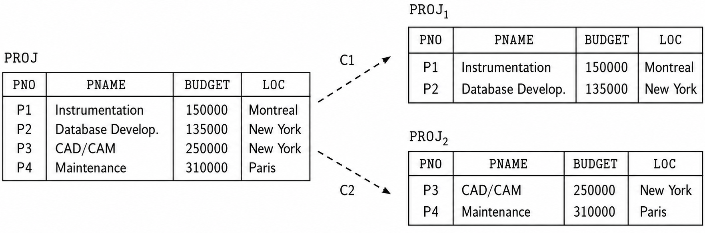](/images/posts/partitioning_vs_sharding/horizontal-partitioning.png)

Elmasri and Navathe define an interesting property of horizontal partitioning:

> _"A set of horizontal fragments whose conditions $$C_1, C_2, … , C_n$$ include all the tuples in R—that is, every tuple in R satisfies ($$C_1$$ OR $$C_2$$ OR … OR $$C_n$$)—is called a **complete horizontal fragmentation** of R. In many cases a complete horizontal fragmentation is also **disjoint**; that is, no tuple in $$R$$ satisfies ($$C_i$$ AND $$C_j$$) for any $$i \neq j$$."_

And to reconstruct the relation R from a **complete horizontal fragmentation**, it is necessary to apply the UNION operation to the partitions.

It's also important to observe that depending on the $$C_i$$ conditions of the horizontal partitioning, this may result in an uneven data distribution among the partitions (**data skew**), as illustrated by the image below where we split the horizontal fragments by the Dno column. This can potentially create **hot spots** and performance bottlenecks, with some partitions overloaded while others are mostly idle. 

[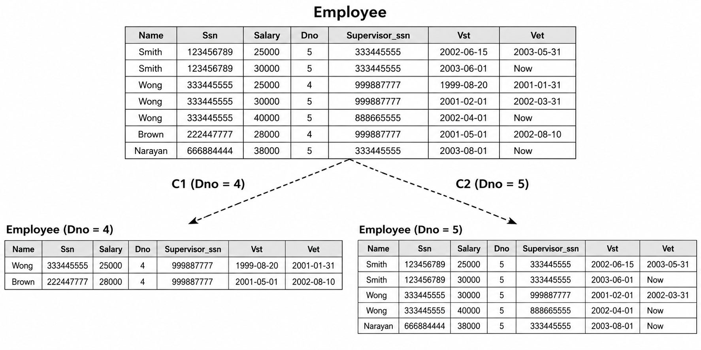](/images/posts/partitioning_vs_sharding/employee-horizontal-partitioning.png)

Both Silberschatz et al and Özsu and Valduriez mention that horizontal partitioning is widely used for parallel and distributed database systems because of its inherent opportunities for both interquery and intraquery parallelism[^intra-inter-query].

[^intra-inter-query]: While interquery allows the parallel execution of a number of queries on various nodes, intraquery allows the parallel execution of a single query by breaking it up into subqueries and executing on various partitions in parallel.
##### Horizontal Partitioning Strategies

Horizontal partitioning can be further divided into different schemes to split the rows into disjoint subgroups:

**1. Round-Robin Partitioning**

For n processors, the ith tuple is assigned to the processor $$i \bmod n$$. This technique is ideally suited for applications that read the entire relation sequentially for each query. As far as the literature goes, it is especially used in RAID disk arrays.

[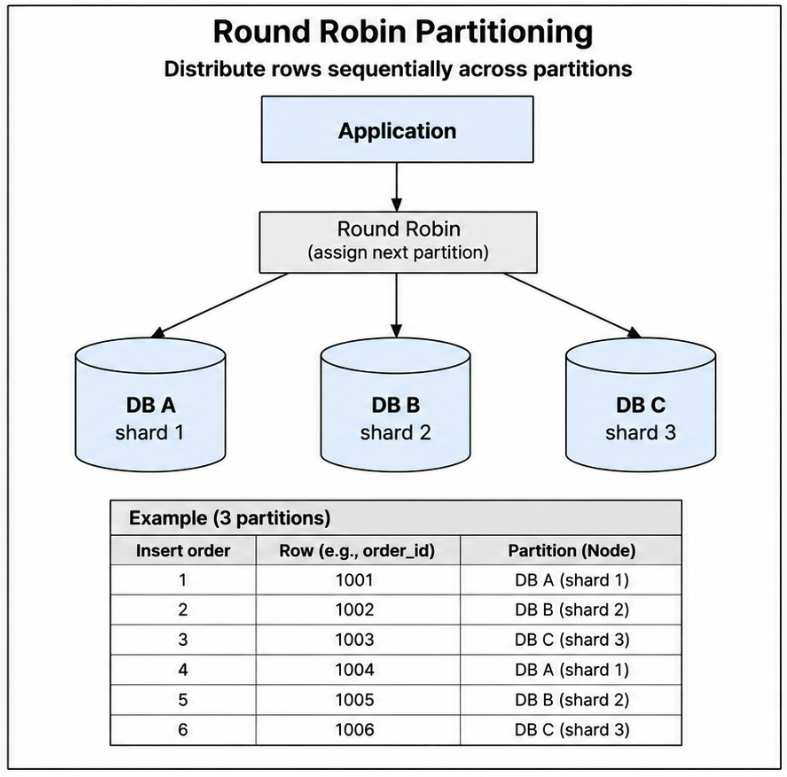](/images/posts/partitioning_vs_sharding/round-robin-partitioning.png)


**2. Hash Partitioning** 

There's a hash function that maps a key value to a partition number. This keeps data evenly distributed even if data grows and shrinks over time. It is best suited for point queries based on the partitioning attribute, but it's also useful for sequential scans over the entire relation or range queries on the partitioning attribute. If the hash function is good, the number of tuples in each node is roughly the same, i.e. $$\frac{1}{N}$$, for $$N$$ nodes. Nevertheless, it is not well suited for point queries on nonpartitioning attributes. 

[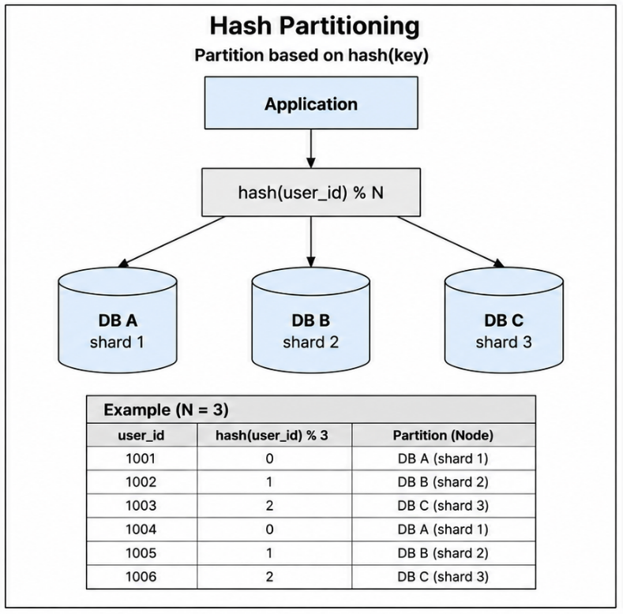](/images/posts/partitioning_vs_sharding/hash-partitioning.png)

**3. Range Partitioning**

This strategy partitions tuples by the range of their key values. Tuples are sorted (conceptually), and n ranges are chosen for the sort key values so that each range contains roughly the same number of tuples. We assign contiguous attribute value ranges to each node. Given a set of nodes $$N_1, N_2, ..., N_n$$, we choose a partitioning attribute $$A$$ and a **partitioning vector** $$[v_1, v_2, ..., v_{n-1}]$$ such that, if $$i < j$$, then $$v_i < v_j$$. The relation $$R$$ is partitioned as follows for a tuple $$t$$, where $$t[A] = x$$:

$$
\begin{cases}
  \text{if } x < v_1 \implies \text{t goes to } N_1 \\
  \text{if } x \geq v_n \implies \text{t goes to } N_n \\
  \text{if } v_i \leq x < v_{i+1} \implies \text{t goes to } N_{i+1}
\end{cases}
$$

[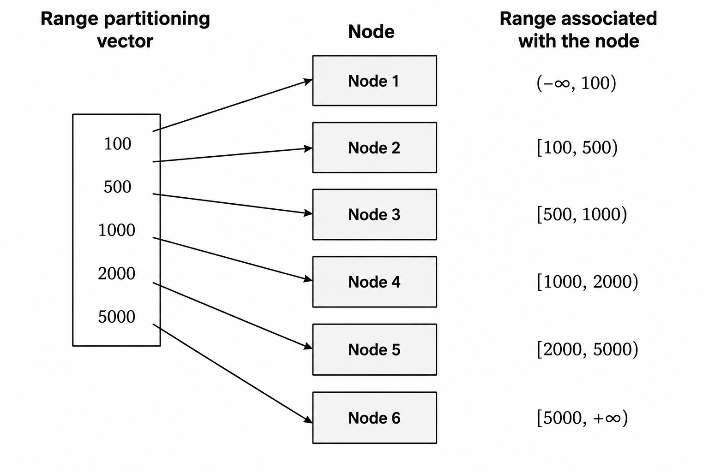](/images/posts/partitioning_vs_sharding/range-partitioning.png)

<!-- ```
Partitioning strategy

   ├── Range
   ├── Hash
   ├── List
   ├── Consistent hash
   ├── Directory
   └── Composite
``` -->

##### Primary and Secondary Horizontal Partitioning

A **primary horizontal partitioning** is a partition defined by predicates on root tables (source tables): tables that exist as independent entities, without any Foreign Key (FK) pointing to it, like, for example, the CUSTOMER table in the example below. This table can be partitioned by its range of IDs, for example. 

On the other hand, **derived horizontal partitioning** is the partitioning of a relation that results from predicates being defined by another relation (that is, the table depends on one or more other tables to exist and have uniqueness). Tables like ORDERS and INVENTORY are examples of such tables, so that we can partition them according to how their referenced parent table (e.g., CUSTOMER) was already partitioned, keeping related rows co-located on the same fragment for faster joins.

[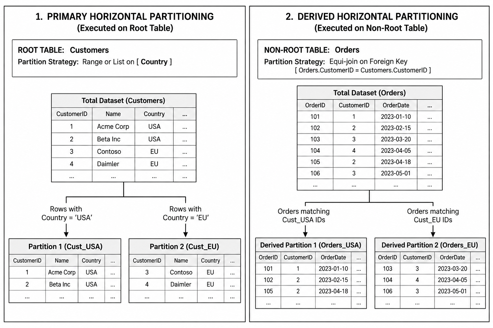](/images/posts/partitioning_vs_sharding/primary-secondary-horizontal-partitioning.png)


##### Vertical Partitioning

Vertical partitioning splits a relation $$R$$ into partitions each containing a subset of $$R$$'s attributes (columns). In other words, it divides a relation "vertically" by columns. This particular kind of data partitioning was successfully implemented by column-store DBMSs like MonetDB/X100, Vertica, Snowflake and DuckDB, for example, as well as columnar open data formats and OLAP query engines.

Vertical Partitioning can be expressed as the relational algebra's PROJECT ($$\pi$$) operation:

$$\pi_{L_i}(R)$$

where $${L_i}$$ is the list of attributes (columns) of $$R$$, for $$i = 1,..., N$$, where $$N$$ is the number of attributes of relation $$R$$.

Suppose that our PROJ table is split by two lists of attributes, $$L_{1} = \{PNO, BUDGET\}$$ and $$L_{2} = \{PNO, PNAME, LOC\}$$

[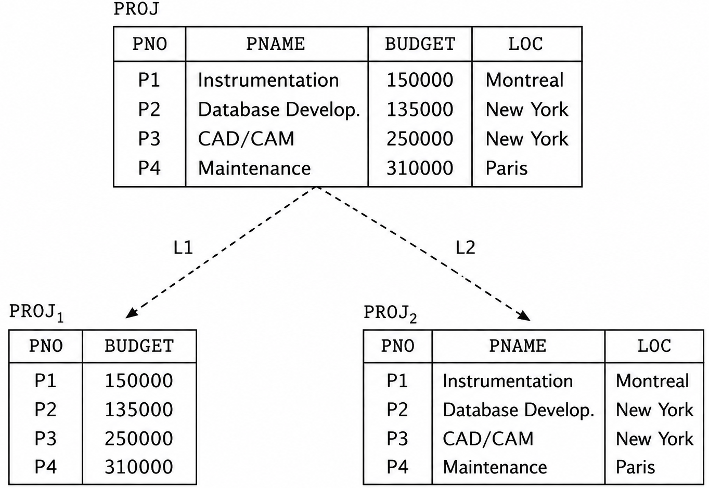](/images/posts/partitioning_vs_sharding/vertical-partitioning.png)

As we can see in the example above, PNO, the Primary Key (PK) of the PROJ table is duplicated on the two fragments -- $$PROJ_{1}$$ and $$PROJ_{2}$$. This is not a coincidence, but a conscious distributed database design decision so that we are able to reconstruct the original relation $$R$$ from its vertical fragments by using an OUTER UNION operation. In other words, our database design has a _lossless-join property_.

A vertical partitioning is said to be a _**lossless-join decomposition**_ if it's always possible to reconstruct the original relation $$R$$ from its vertical fragments $$L_1, L_2, ... L_n$$. This is more succinctly expressed in relational algebra as: 

$$ R = \pi_{L_{1}}(R) \bowtie \pi_{L_{2}}(R)$$

That is, the natural join of the projection results _exactly_ in the original relation $$R$$. Conversely, if the same natural join computation results in a **superset** of the original relation then the decomposition is said to be lossy. This can be expressed succinctly in the relational algebra as:

$$R \subset \pi_{L_{1}}(R) \bowtie \pi_{L_{2}}(R)$$

Figure 2.2 in Georgiev's thesis[[6]](#ref-georgiev2008) shows examples of a lossy (a) and a lossless (b) decomposition.

[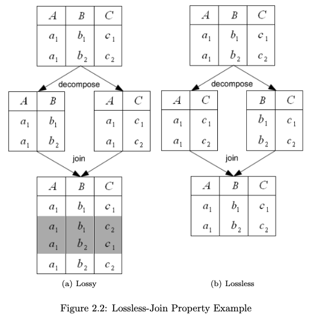](/images/posts/partitioning_vs_sharding/lossless-lossy-decomposition.png)

Finally, Ramakrishnan and Gehrke state the following about  vertical partitioning:

> _"To ensure that a vertical fragmentation is lossless-join, systems often assign a **unique tuple id** to each tuple in the original relation, as shown in Figure 22.4, and attach this id to the projection of the tuple in each fragment. If we think of the original relation as containing an additional tuple-id field that is a key, this field is added to each vertical fragment. Such a decomposition is guaranteed to be lossless-join."_

As described by Elmasri and Navathe, a set of vertical partitions whose projection lists $$L_1, L_2, ... , L_n$$ include all the attributes in $$R$$ but share only the primary key attribute of R is called a **complete vertical fragmentation** of $$R$$. Therefore, in this case, the projection lists satisfy the following conditions:
1. $$L_1 \cup L_2 \cup ... \cup L_n = ATTRS(R)$$;
2. $$L_i \cap L_j = PK(R)$$, for any $$i \neq j$$, 

where ATTRS(R) is the set of all attributes of R and PK(R) is the primary key of R;

And to reconstruct the relation R from a complete vertical fragmentation, we apply the OUTER UNION operation to the vertical fragments. Furthermore, for the $$R_1, R_2, ... R_n$$ vertical fragments of $$R$$, we have that $$R_1 \cap R_2 \cap ... \cap R_n = A$$, where $$A$$ is a unique key attribute of $$R$$.

##### Hybrid Partitioning

A **hybrid partitioning** is the combination of horizontal partitioning and vertical partitioning, also called **mixed partitioning**. In this kind of partitioning, a fragment of a relation R can be specified by a SELECT-PROJECT combination of operations $$\pi_L(\sigma_C(R))$$, and the original relation $$R$$ can be reconstructed by applying UNION **and** OUTER UNION (or OUTER JOIN) operations in the appropriate order.

In the Employee table example, if we partition by Department Number (Dno) and Social Security Number (SSN), there are four resulting partitions:

[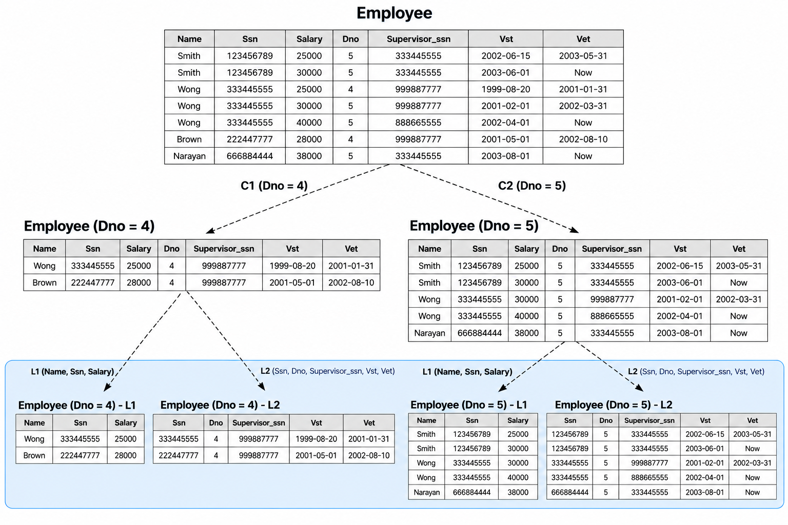](/images/posts/partitioning_vs_sharding/employee-hybrid-partitioning.png)


### 2. Allocation

Allocation assigns a fragment to a particular node. The choice of site and degree of replication will be driven by performance and availability requirements. Some partitions may be replicated across all nodes of the system, while others remain local to a particular site, for example. 

### 3. Replication

Replication allows the storage of several copies of data to achieve data locality (i.e., keep the data closer to where it is most needed), availability (the probability that a system is continuously available during a time interval), reliability (the probability that a system is running at a certain point in time) and faster query execution by using local copies.

The logical units of replication will vary depending on the requirements of the application, performance requirements, patterns of access, types and frequencies of transactions, and availability requirements. Basically, there are two extremes of replication: no replication at all -- that is, each relation or fragment is stored in a single node -- on one side and whole database replication on all nodes on the other side (called a _fully replicated database_). In between, we have a spectrum of partial replications of tables and table partitions. For example, H-Store/VoltDB supports both partitioned and replicated tables (that is, the whole table is replicated among all the nodes). The latter is used for small tables that are read-only or not frequently updated like a COUNTRY table, for example, while other tables are horizontally partitioned among the nodes.


A thorough treatment of replication is beyond the scope of this blog post, but it's strongly recommended that interested readers check Özsu and Valduriez's[[2]](#ref-ozsu2020), Kleppmann and Riccomini's[[4]](#ref-kleppmann2026), or Petrov's[[5]](#ref-petrov2019) chapters devoted to this subject.

## So what is sharding (_in the academic perspective_), after all? 

All the authors cited so far address _sharding_ in their works, but with slightly different nuances among them. **For Özsu and Valduriez, Elmasri and Navathe, Ramakrishnan and Gehrke, and Silberschatz et al, _sharding is a synonym for horizontal partitioning_**, and they acknowledge that the term is especially widespread in the context of NoSQL databases, Big Data, and Cloud Computing systems.

But Silberschatz et al also argument that in sharding architectures each node can have a traditional centralized, _maybe independent_, database instance (like standalone full MySQL DB instances, for example) and the queries would be routed by a middleware. In this architectural model, the sharding query requests can be executed by the database, or a middleware, or even application code. Each shard is an independent and standalone database that replicates all the database schema, but has only $$\frac{1}{N}$$ of the data, in a cluster of size N.

## Key Takeaways

Based on what we have seen so far, a more concise definition of _sharding_ could be:

> **Sharding is horizontal partitioning of data distributed across different nodes.**

And we may establish the following relation:

> **Every sharding is a partitioning, but not every partitioning is a sharding.**

This derives directly from the fact that there are partitioning on a single node, for example, while sharding usually involves horizontal partitioning + allocation among various nodes. Therefore, a key takeaway relationship among all of the main concepts exposed so far could be:

$$Sharding \subseteq \text{Horizontal Partitioning} \subseteq Partitioning$$

Or as a cool cheat sheet:

[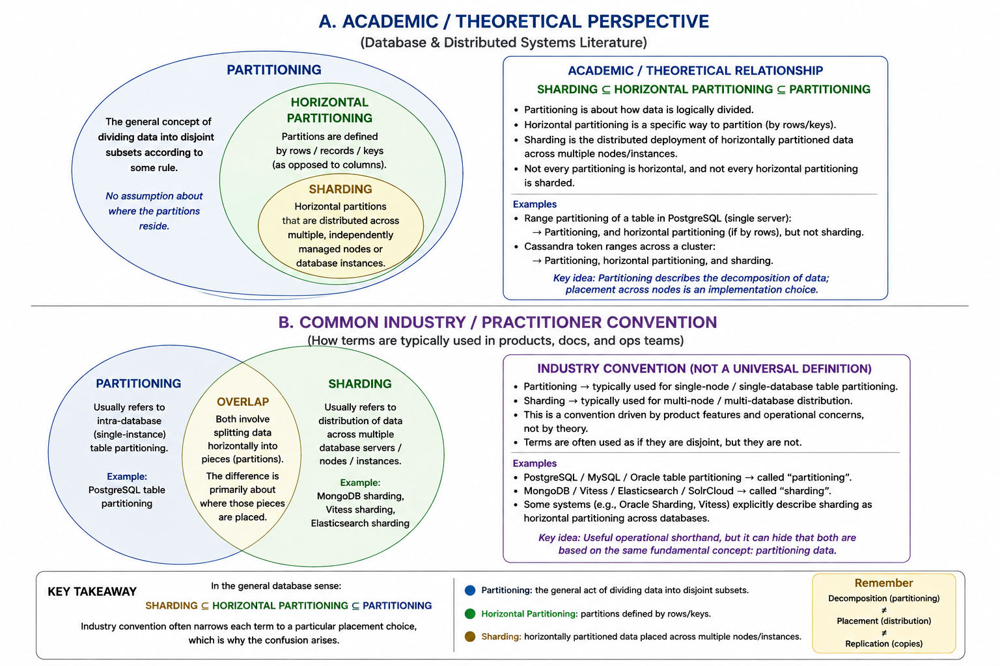](/images/posts/partitioning_vs_sharding/key-takeways.png)

## References

1. <span id="ref-ramakrishnan2003"></span>Ramakrishnan, R., & Gehrke, J. (2003). *[Database Management Systems](https://pages.cs.wisc.edu/~dbbook/openAccess/thirdEdition/supporting_material.htm)* (3rd ed.). McGraw-Hill.
2. <span id="ref-ozsu2020"></span>Özsu, M. T., & Valduriez, P. (2020). *[Principles of Distributed Database Systems](https://cs.uwaterloo.ca/~ddbook/)* (4th ed.). Springer.
3. <span id="ref-silberschatz2020"></span>Silberschatz, A., Korth, H. F., & Sudarshan, S. (2020). *[Database System Concepts](https://www.db-book.com/)* (7th ed.). McGraw-Hill.
4. <span id="ref-kleppmann2026"></span>Kleppmann, M., & Riccomini, C. (2026). *[Designing Data-Intensive Applications](https://www.oreilly.com/library/view/designing-data-intensive-applications/9781098119058/)* (2nd ed.). O'Reilly.
5. <span id="ref-petrov2019"></span>Petrov, A. (2019). *[Database Internals](https://www.databass.dev/)* (1st ed.). O'Reilly.
6. <span id="ref-georgiev2008"></span>Georgiev, N. (2008). *A Web-Based Environment For Learning Normalization of Relational Database Schemata* (Master's thesis).
