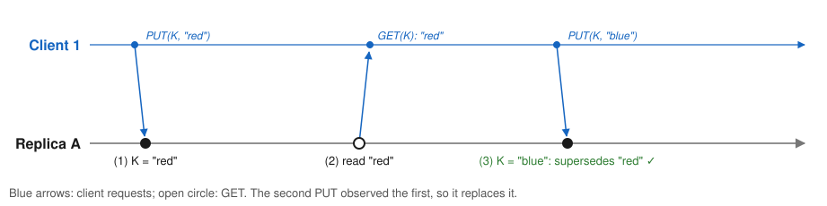
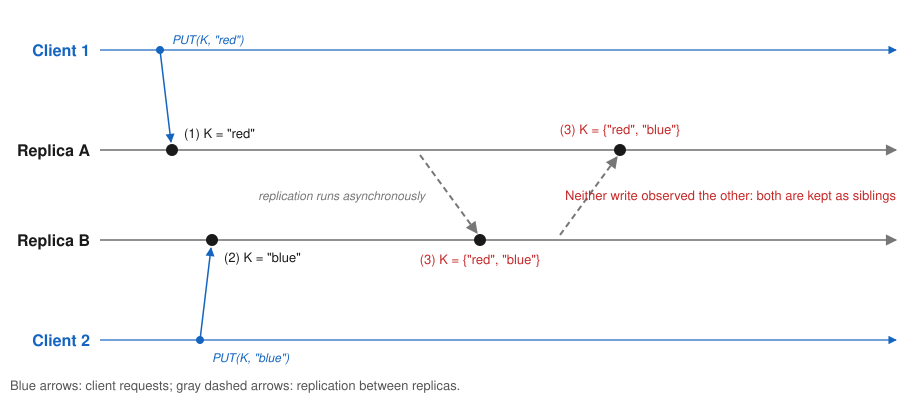
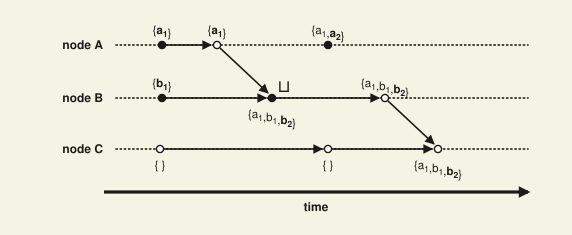
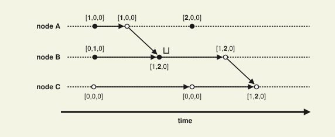
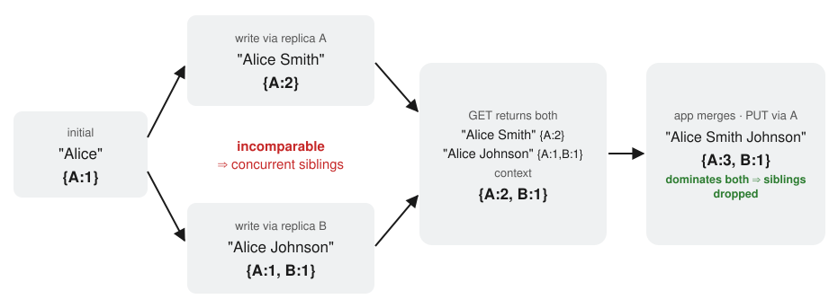
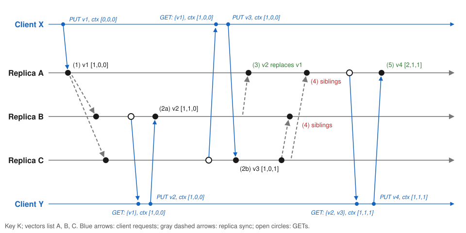
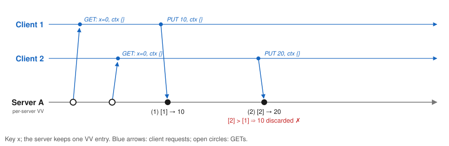
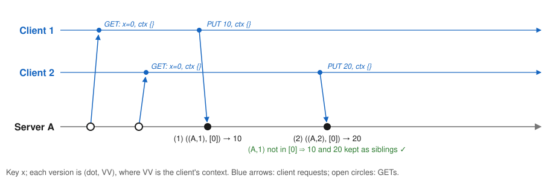
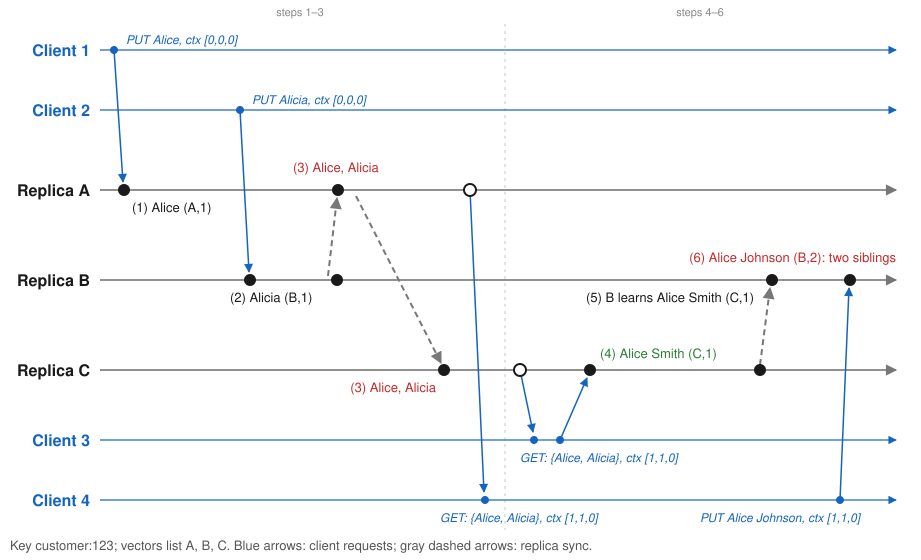

## Introduction

Recently, I gave a lecture on Logical Clocks[^logical-clocks-slides]. While I learned about _Lamport Clocks (LC)_ and _Vector Clocks (VC)_ a long time ago, still during my undergraduate years, this talk presented itself as a fortuitous opportunity to:

[^logical-clocks-slides]: An extended version of the lecture slides, in English, is available [here](/files/logical-clocks-v8.pdf)

1) revisit the classical logical clocks with their assumptions, and causality guarantees;

2) get in touch with _"recent"_ (of the last... yikes, 16 years! 😆) logical clocks like _Hybrid Logical Clocks (HLC), Bloom Clocks (BC)_; and

3) study logical clocks of the 80s and 90s that flew under my radar until now, like _Matrix Clocks (MC)_ and _Version Vectors (VV)_.

For this lecture, I used **Beyond Clocks** ([Gakhov, 2026](#ref-gakhov2026){: #cite-gakhov2026-1}) book as the main reference guide, while also checking out related papers. Among the myriad of papers, I found _"Why Logical Clocks Are Easy"_ ([Baquero and Preguiça, 2016](#ref-baquero2016){: #cite-baquero2016-1}) particularly interesting and engaging for its _causally tracking driven approach_ to logical clocks, with a special focus on _**Causal Histories (CH)**_, a cool formalism that I didn't know about, that makes the rules of logical clocks much more natural and understandable. This paper provided the unifying backbone of the cited lecture.

While I (_like to_) think that I have a good grasp of LC and VC, I found it more challenging to grasp Dotted Version Vectors (DVVs). Reading  _"Dotted Version Vectors: Logical Clocks for Optimistic Replication"_ ([Preguiça et al., 2010](#ref-preguica2010){: #cite-preguica2010-1}), and _"Dotted Version Vectors: Efficient Causality Tracking for Distributed Key-Value Stores"_ ([Preguiça et al., 2012](#ref-preguica2012){: #cite-preguica2012-1}) was not as smooth as I had anticipated. 😅 And the fact that I was totally unaware of Version Vectors ([Parker et al., 1983](#ref-parker1983){: #cite-parker1983-1}) until reading Andrii's book didn't help either. So I had to do a more focused effort to _really_ understand VV and DVV's guarantees, invariants and assumptions. 

_This post is a direct result of those efforts, plus an additional take on Dotted Version Vector Sets (DVVS)._

## Motivation and Context

Version Vectors (VV) and Dotted Version Vectors (DVV) are especially used in [eventually consistent](#ref-vogels2009){: #cite-vogels2009-1} replicated key-value (KV) stores, such as Amazon's original Dynamo ([DeCandia et al., 2007](#ref-decandia2007){: #cite-decandia2007-1}), Riak ([Riak](#ref-riak-causal){: #cite-riak-causal-1}) and Redis Active-Active ([Redis](#ref-redis-aa){: #cite-redis-aa-1}), which uses vector clocks alongside CRDTs.

These data stores provide two main operations:

* **GET(K)**: returns the value stored under a key K, if it exists. If there were concurrent updates, it returns all versions (called _siblings_), plus a **causal context** that summarizes what the client has seen;

* **PUT(K, V)**: writes value V under key K. Most KV stores implement this as an UPSERT operation. Nevertheless, here we want to keep the concurrent updates to the same key, whether different clients sent them to the same node or not. _So the client sends the new value along with the **causal context** it got from an earlier GET_. The replica discards any stored versions the new one supersedes (dominates), and the rest remains as siblings. A _PUT_ without a context claims to have seen nothing, so it should only add a sibling;

These databases also support other operations, such as DELETE(K) or SCAN(), for example, but we leave them out in this post to focus on GET and PUT. The figures below show two scenarios that motivate the use of VV and DVV. In [Figure 1](#figure-1), the same client sends two consecutive updates (PUT) so that the second one supersedes the first.

<a id="figure-1">Figure 1</a> - Sequential writes

In [Figure 2](#figure-2), two clients send concurrent updates (PUT) to the same key, so they should be kept as siblings.

<a id="figure-2">Figure 2</a> - Concurrent writes

## Causal Histories

A Causal History (CH) is a set of unique events created by the _**happened-before**_ relation, as defined by Lamport ([Lamport, 1978](#ref-lamport1978){: #cite-lamport1978-1}). Each time a new event happens -- _a local event, a send message event, or a receive message event_ --, its unique name is included in a set (the causal history) by the node where the event happened. Each event is identified by a new unique name using, for example, the node name and a local monotonically increasing counter (e.g., $$a_1, a_2, a_3$$).

[Figure 3](#figure-3) shows the CH for a group of replica nodes A, B, and C. Each black dot represents an update event to a specific data object, while the white dots represent a non-update event like, for example, the message passing among nodes, or a read operation by a client (not shown).

<a id="figure-3">Figure 3</a> - Causal histories with only some relevant events (adapted from [Baquero and Preguiça, 2016](#ref-baquero2016){: #cite-baquero2016-2})

We start with both nodes A and B doing _concurrent_ update events ($$a_1$$ and $$b_1$$, respectively) to the same object -- for example, the concurrent execution of two PUT operations that share the same key K, but have different values --, producing histories $$H_a = \{a_1\}$$ and $$H_b = \{b_1\}$$, respectively. Then node A sends its updated data object and CH $$H_a$$ as a message to node B, that incorporates its own CH, producing $$H_b = \{a_1, b_1, b_2\}$$. The new $$b_2$$ update event is also created, possibly resulting from a merge operation that reconciles the two divergent versions from node A and B. Later on, node C, whose CH was empty because no update event happened on it, receives the $$H_b$$, so we have $$H_a=\{a_1, a_2\}$$ and $$H_b = H_c = \{a_1, b_1, b_2\}$$.

As stated in [Baquero and Preguiça, 2016](#ref-baquero2016){: #cite-baquero2016-3}, checking causality between two events x and y can be done by a simple set inclusion test on their causal histories:

$$ x \rightarrow y \Leftrightarrow H_x \subsetneq H_y $$ 

This can be read as _"if x happened-before y then $$H_x$$ is a strict subset of $$H_y$$, and vice-versa"_. In other words, $$H_x$$ is a subset of $$H_y$$, but there is _at least_ one more element in $$H_y$$, so that the two sets are not equal.

One nice observation by [Baquero and Preguiça, 2016](#ref-baquero2016){: #cite-baquero2016-4} is that:

> "... the mechanism of building the causal history implies if an event $$b_3$$ is present in $$H_y$$, then all preceding events from that same node, $$b_1$$ and $$b_2$$, are also present in $$H_y$$. Thus, it suffices to store the most recent event from each node. Causal history $$\{a_1, a_2, b_1, b_2, b_3, c_1, c_2, c_3\}$$ is compacted to $$\{a \rightarrow 2, b \rightarrow 3, c \rightarrow 3\}$$ or simply a vector [2, 3, 3]."

This can be seen in [Figure 4](#figure-4). Therefore, _version vectors (and vector clocks) are compacted versions of the causal history._

<a id="figure-4">Figure 4</a> - Version vectors with only some relevant events (adapted from [Baquero and Preguiça, 2016](#ref-baquero2016){: #cite-baquero2016-5})

## Version Vectors

A Version Vector (VV) ([Parker et al., 1983](#ref-parker1983){: #cite-parker1983-2}) is defined as vector $$VV(x)=[v_1, \ldots, v_N]$$ where $$x$$ is the object being updated, and $$v_i$$ counts the updates to object _x_ that originated at replica node (or client) _i_. VVs are pretty similar to VCs, but only increments its own counter when there's an update, not for every event happening in the distributed system. In other words, a VV is a compressed causal history of the object's update events. This highlights one important distinction between Version Vectors and Vector Clocks[^footnote-baquero].

> While Version Vectors and Vector Clocks are _pretty_ similar in structure and rules, _Vector Clocks are concerned with the **causality tracking of events** in a distributed system_ (i.e., **a process centric view**), while _Version Vectors are concerned with the **causality tracking of data  update events** in a replicated data store (i.e., **a data-centric view**)_. 

[^footnote-baquero]: By the way, check out Baquero's [_"Version Vectors are not Vector Clocks"_](https://haslab.wordpress.com/2011/07/08/version-vectors-are-not-vector-clocks/) (2011) post for more context on this important difference!

We compare VVs component-wise, exactly like VC:

* **Dominates:** we say that $$VV_2$$ **dominates** $$VV_1$$ ($$VV_1 < VV_2$$), if and only if, $$VV_2$$ includes every update $$VV_1$$ has, plus one or more elements in the array that are strictly larger than in $$VV_1$$. Formally, $$VV_1 < VV_2 \iff \forall i: VV_1[i] \le VV_2[i] \land \exists j: VV_1[j] < VV_2[j]$$. For example, $$[2,1,0] < [2,2,0]$$ because the first history is contained in the second;

* **Equal:** same set of updates, that is: $$VV_1=VV_2$$;
  
* **Incomparable:** we have $$\neg(VV_1 \le VV_2) \land \neg(VV_2 \le VV_1)$$, that is, no VV dominates the other, so the VVs are said to be concurrent: $$VV_1 \parallel VV_2$$. This implies conflicting versions, so we keep them both as _siblings_. 

**The VV detects the conflict, but it does not decide how to merge the values!** This should be addressed by either the datastore or the application layer. For example, Riak, that uses a variation of DVV, offers the possibility of using application/client merge, Last-Write-Wins (LWW), or CRDT data types to reconcile conflicting versions.

[Figure 5](#figure-5) shows an example of the kind of conflict that could happen with two replica nodes A and B. 

<a id="figure-5">Figure 5</a> - Version Vector conflict example

Given two replica nodes A and B, we initially had the value _"Alice"_ under a key K by node A ($$VV_{A_1} = [1, 0]$$). Then two concurrent updates for the same key K happened on replicas A and B, with the values _"Alice Smith"_ ($$VV_{A_2} = [2, 0]$$) and _"Alice Johnson"_ ($$VV_{B_1} = [1, 1]$$), respectively. Both updates on replicas A and B supersede (dominate) the initial value on replica A, $$ VV_{A_1} < VV_{A_2} $$ and $$VV_{A_1} < VV_{B_1}$$, but $$VV_{A_2}$$ and $$VV_{B_1}$$ don't dominate each other (i.e., $$ VV_{A_2} \nless VV_{B_1} \land VV_{B_1} \nless VV_{A_2} $$), so they are said to be concurrent, $$VV_{A_2} \parallel VV_{B_1}$$ and their values are kept as siblings, merging the two vectors via anti-entropy between replicas A and B. A later GET operation retrieves the siblings _"Alice Smith"_ and _"Alice Johnson"_ with the merged context $$ctx = [2, 1]$$. Finally, a followup PUT operation saves _"Alice Smith Johnson"_ ($$VV_{A_3} = [3, 1]$$) on replica A, whose VV dominates both $$VV_{B_1}$$ and $$VV_{A_2}$$, and their associated values can be discarded.

#### Version Vector Algorithm

As we can see in VV Algorithm 1, each replica has a $$S_i$$, a set of _(vv, value)_ pairs for a particular key K. While the GET operation returns the merged VV of all siblings, as context, plus a set of all concurrent values, the PUT operation uses the context sent by the client to discard any superseded VV in $$S_i$$. One important function is SYNC that, synchronously or asynchronously, merges other replicas' $$S$$ sets and discards any superseded versions and its related values.

<pre class="pseudocode">
\begin{algorithm}
\caption{Version Vectors (per-server replica)}
\begin{algorithmic}
\STATE \textbf{Data:} replica $R_i$ with counter $n_i \gets 0$ \textbf{and} versions $S_i \gets \emptyset$ \COMMENT{$S_i$: set of $(vv, value)$ pairs; concurrent ones are siblings}
\STATE
\FUNCTION{Get}{}
  \STATE $ctx \gets [0, \ldots, 0]_N$
  \STATE $values \gets \emptyset$
  \FOR{each $(vv, value) \in S_i$}
    \STATE $ctx \gets$ \CALL{Merge}{$ctx, vv$} \COMMENT{merge causal contexts}
    \STATE $values \gets values \cup \{value\}$
  \ENDFOR
  \RETURN $(values, ctx)$
\ENDFUNCTION
\STATE
\FUNCTION{Put}{$value, ctx$}
  \STATE $n_i \gets n_i + 1$ \COMMENT{assumes $ctx[i] \le n_i$; DVV uses $\max(\ldots, ctx[i])$}
  \STATE $vv \gets$ \CALL{Copy}{$ctx$}
  \STATE $vv[i] \gets n_i$ \COMMENT{allocate a new version}
  \FOR{each $(u, v) \in S_i$}
    \IF{\CALL{Dominates}{$vv, u$}}
      \STATE remove $(u, v)$ from $S_i$ \COMMENT{superseded}
    \ENDIF
  \ENDFOR
  \STATE $S_i \gets S_i \cup \{(vv, value)\}$ \COMMENT{keep concurrent siblings}
\ENDFUNCTION
\STATE
\FUNCTION{Merge}{$u, v$} \COMMENT{$N$ = number of replicas}
  \FOR{$k \gets 1$ \TO $N$}
    \STATE $out[k] \gets \max(u[k], v[k])$
  \ENDFOR
  \RETURN $out$
\ENDFUNCTION
\STATE
\FUNCTION{Sync}{$S_j$} \COMMENT{anti-entropy with $R_j$}
  \STATE $S \gets S_i \cup S_j$
  \STATE $out \gets S$
  \FOR{each $(u, v) \in S$}
    \FOR{each $(w, x) \in S$}
      \IF{\CALL{Dominates}{$w, u$}}
        \STATE remove $(u, v)$ from $out$ \COMMENT{$w$ has seen $u$}
        \BREAK
      \ENDIF
    \ENDFOR
  \ENDFOR
  \STATE $S_i \gets out$
\ENDFUNCTION
\STATE
\FUNCTION{Dominates}{$u, v$} \COMMENT{$u$ has seen all of $v$}
  \FOR{$k \gets 1$ \TO $N$}
    \IF{$u[k] \lt v[k]$}
      \RETURN \FALSE
    \ENDIF
  \ENDFOR
  \RETURN $u \neq v$ \COMMENT{$\ldots$ and at least one more update}
\ENDFUNCTION
\end{algorithmic}
\end{algorithm}
</pre>

Let's see one example of this algorithm for three replicas (A, B, and C) and two clients (X and Y) in [Figure 6](#figure-6).

All the updates are related to a single key K. The vectors follow the $$[A, B, C]$$ order and, as in Algorithm 1, each replica's set $$S$$ holds $$(vv, value)$$ pairs. Initially, $$n_A = n_B = n_C = 0$$ and $$S_A = S_B = S_C = \emptyset$$.

<a id="figure-6">Figure 6</a> - Version vectors with two clients and three Replicas

**Step 1:** Client X issues a _PUT(v1, ctx=[0, 0, 0])_ on Replica A, updating $$VV_{A_1}$$ to $$[1, 0, 0]$$ and $$S_A$$ to $$\{([1, 0, 0], v1)\}$$. Later on, Replica A sends its state to Replicas B and C (this is called an anti-entropy process), and both replicas run $$SYNC(S_A)$$, and we have $$S_A = S_B = S_C = \{([1, 0, 0], v1)\}$$;

**Step 2a:** Client Y issues a _GET_ that returns _{v1, ctx=[1,0,0]}_, followed by a _PUT(v2, ctx=[1, 0, 0])_ on Replica B, updating $$VV_{B_1}$$ to $$[1, 1, 0]$$. As $$VV_{A_1} < VV_{B_1}$$ then v2 replaces v1 on Replica B, so we have $$S_B=\{([1, 1, 0], v2)\}$$;

**Step 2b:** Concurrently, Client X issues a _GET_ that returns _{v1, ctx=[1,0,0]}_, followed by a _PUT(v3, ctx=[1, 0, 0])_ on Replica C, updating $$VV_{C_1}$$ to $$[1, 0, 1]$$. As $$VV_{A_1} < VV_{C_1}$$ then v3 replaces v1 on Replica C, and $$S_C=\{([1, 0, 1], v3)\}$$. Note that neither client saw the other's write, so v2 and v3 are concurrent;

**Step 3:** Replica B sends its state to Replica A, that runs $$SYNC(S_B)$$. As $$VV_{A_1} < VV_{B_1}$$ then v2 replaces v1 on Replica A too, so $$S_A=\{([1, 1, 0], v2)\}$$;

**Step 4:** Replica C sends its state to Replicas A and B, and both replicas run $$SYNC(S_C)$$. As $$VV_{B_1} \parallel VV_{C_1}$$, we keep both versions as siblings, so $$S_A = S_B = \{([1, 1, 0], v2), ([1, 0, 1], v3)\}$$. Replica C still holds only $$S_C=\{([1, 0, 1], v3)\}$$, because v2 didn't reach it yet;

**Step 5:** Client Y issues a GET on Replica A and receives both siblings, plus the merged context $$ctx=[1, 1, 1]$$. Then it executes a _PUT(v4, ctx=[1, 1, 1])_ on Replica A, updating $$VV_{A_2}$$ to $$[2, 1, 1]$$. As $$VV_{B_1} < VV_{A_2}$$ and $$VV_{C_1} < VV_{A_2}$$ then v4 replaces both v2 and v3, therefore $$S_A=\{([2, 1, 1], v4)\}$$. Eventually, Replicas B and C will receive this new version too;

## A corner-case for Version Vectors

While VV can track a partial order of events and detect concurrent updates, given that each version maintains an accurate causal history, there is a problem that can happen when the server ids are used to build the version vector of an individual version, as seen in [Figure 7](#figure-7). 

<a id="figure-7">Figure 7</a> - Version Vector corner case: a concurrent write is discarded

In this case, both clients read the initial empty context (ctx={}) then submit concurrent PUTs. The second PUT creates a new version with VV [2], which dominates [1] and generates a false causality, so the previous value (10) is discarded in favor of the second value (20). This can be seen as an example of read-then-write race condition that could happen even if the initial context is not empty!

This could be avoided by using per-client entries, but this solution is not scalable with the number of clients. **Dotted Version Vectors were created to solve this problem: accurately tracking causal context while avoiding the version vector explosion and still being scalable by using server ids.**

## Dotted Version Vectors

A Dotted Version Vector (DVV) is defined as a pair $$DVV=(d, VV)$$  where the version vector $$VV$$ represents the **causal predecessors** of an object version, and **dot** $$d=(i,n)$$ uniquely identifies the event that created that version. The pair _(i,n)_ of the dot is composed by the replica id _i_ and a unique monotonically increasing number _n_. 

**_The DVV separates the identity of a particular update from its causal history._** _And each stored version has its own dotted version vector._

Two dots _(A,1)_ and _(A,2)_, for example, are ordered in replica A's counter sequence, but this **does not** imply that the client updates they identify are causally related. The causality will be determined by the VV (causal context) that is coupled with each dot. This assumes that each replica numbers its events sequentially, and that VV describes a contiguous prefix of observed events (a _downset_ invariant that must be satisfied, as we will see soon).

The DVV complete causal history is defined as:

$$H(d,VV)=H(VV)\cup \{d\}$$, where $$H(VV)=\{(i,k) \mid i \in \text{replicas},\ 1 \le k \le VV[i]\}$$.

Suppose a $$DVV=((C, 4), [2, 3, 1])$$, its causal history $$H$$ is:

$$H(DVV) = \{a_1, a_2, b_1, b_2, b_3, c_1, c_4\}$$

  > **Invariant:** A DVV's history is causal context + exactly one new event.
  >
  > The new version claims to have seen exactly what the client's causal context says, plus its own new event. Thanks to this property, we can avoid both lost writes and false conflicts.

The paper by [Preguiça et al., 2010](#ref-preguica2010){: #cite-preguica2010-2} establishes that, for each key K, each server $$i$$ stores a set of (dvv, value) pairs: $$S_i = \{(dvv_1, value_1), (dvv_2, value_2), ..., (dvv_n, value_n)\}$$. In the cited paper, the DVV notation is represented as a set-based triple $$(r, m, n)$$ where _r_ is the replica id, _m_ is a **gap-free prefix of events**, _n_ is the update event _(r, n)_ and the condition _n > m_ should always be satisfied.

The "gap-free prefix of events" describes one important invariant of DVVs, called _**downset**_.

> **Invariant:** _(downset)_ Events that happened on a replica should not have gaps until the largest known counter.
>
> In other words, every VV set that a replica stores, or hands to a client as a context, describes a history with no holes.
> In a node C, the c4 is the 4th write coordinated by it. A history is a downset if, for every node, it contains a whole prefix of that node's events. It has no gaps. For example:
>
>* {a1, a2, a3, b1, b2} is a downset;
>* {a1, a2, a3, b1, b2, c1, c2, c4} **is not** a downset, because c3 is missing;

Also in the papers, the causal history (context) is represented as $$C[(r,m,n)] = \{r_i \mid 1 \le i \le m\} \cup \{r_n\}$$. Here are some examples of DVV and their respective causal contexts:

$$dvv = (A, 0, 1) \implies C[dvv] = \{a_1\}$$

$$dvv = (A, 0, 2) \implies C[dvv] = \{a_2\}$$

$$dvv = (A, 1, 2) \implies C[dvv] = \{a_1, a_2\}$$

$$dvv = (A, 3, 7) \implies C[dvv] = \{a_1, a_2, a_3, a_7\}$$

For version vectors $$c_1$$ and $$c_2$$ and their respective causal histories $$H(c_1)$$ and $$H(c_2)$$ we have that:

$$ c_1 \leq c_2 \Leftrightarrow H(c_1) \subseteq H(c_2)$$

$$ c_1 \lt c_2 \Leftrightarrow H(c_1) \subsetneq H(c_2)$$

When $$H(c_1) \subsetneq H(c_2)$$ we say that $$c_2$$ **dominates** $$c_1$$, therefore the version associated with $$c_1$$ can be discarded.

[Preguiça et al., 2010](#ref-preguica2010){: #cite-preguica2010-3} also defines two operations:

* $$SYNC(S_1, S_2)$$: returns a new set S that is the union of $$S_1$$ and $$S_2$$, but discarding superseded versions. This operation preserves concurrent versions;
* $$UPDATE(S, S_r, r)$$: returns the clock for a new version written at replica _r_, that is, the client's context _S_ plus a new event, using the next counter of _r_, that is computed from the replica's current set $$S_r$$;

The authors propose to implement the KV store GET and PUT using these two operations. Strictly speaking, in the original DVV papers the context returned by a GET is the opaque set of the siblings' clocks, not a single VV. But, as this set is a downset, we can collapse it into the entry-wise maximum of the clocks, and that's exactly what UPDATE does (and what DVVS returns right away).

_The DVV and DVVS pseudocode in this post are modified versions of the ones presented in the original papers._ In the mentioned papers, a GET is performed by the replica node asking a subset of replicas (e.g., a quorum) and reducing their replies with a SYNC. And a PUT is performed by a single replica node running UPDATE, followed by a SYNC with other replica nodes.

> **Invariant:** each dot is globally unique
>
> Every write must get a dot `(r, n)` that no other write has seen. DVV can guarantee this by 1) having each replica node `r` generating the next counter `n`, and 2) having both `UPDATE` and `SYNC` run as one atomic step on the replica node. Therefore, two writes carrying the same context on the same replica node will get different dots, and show up as concurrent. A server provided ID's VV alone couldn't tell them apart.
>

In this post we use [Preguiça et al., 2012](#ref-preguica2012){: #cite-preguica2012-2} DVV notation: 

$$DVV = (dot, \text{causal context})$$

where the causal context is the VV that predates the current update.

##### But where does the next counter come from? 

If you compare Algorithm 1 and Algorithm 2, you'll notice that the replica's counter $$n_i$$ is gone. So, where does the next counter come from? I scratched my head for a while on this one until I realized that it is right there, hidden in the versions themselves! 😅

Let's jump ahead to step 5 of the DVV walkthrough of Figure 6 (below). Replica A doesn't store $$dvv_1$$ anymore, so how does it know that its next counter is 2? Because the versions that superseded $$dvv_1$$ carry A's counter in their VVs: $$dvv_2$$ and $$dvv_3$$ both have $$VV[A] = 1$$. In other words, $$\lceil S \rceil_r$$ -- the largest counter of replica r found in a set of versions S, either in a dot or in a VV entry -- is all we need, just like the paper's UPDATE does. No separate counter required!

But what if the replica knows less than the client? Think of a replica that lost data, or was restored from an old backup. If it relied only on its own versions, it could hand out a dot that the client has already seen. That's why we follow the DVV **EVENT** function of [Almeida et al., 2014](#ref-almeida2014){: #cite-almeida2014-1}, and also take the client's context into account: the new dot is $$(r, \max(\lceil S_r \rceil_r, ctx[r]) + 1)$$.

So what happens with a DELETE? If we just erase all the versions of a key, the counters restart from 1, and old dots get reused! That's why real data stores keep a tombstone instead, that is, a version without value that still carries the causal context.

<pre class="pseudocode">
\begin{algorithm}
\caption{Dotted Version Vectors (one DVV per version)}
\begin{algorithmic}
\STATE \textbf{Data:} replica $R_i$ with versions $S_i \gets \emptyset$ \COMMENT{$S_i$: $(X, value)$ pairs; $X = (d, VV)$}
\STATE
\FUNCTION{Get}{}
  \STATE $values \gets \emptyset$
  \FOR{each $(X, value) \in S_i$}
    \STATE $values \gets values \cup \{value\}$
  \ENDFOR
  \FOR{each replica id $r$}
    \STATE $ctx[r] \gets$ \CALL{MaxCounter}{$S_i, r$} \COMMENT{all VVs and dots seen}
  \ENDFOR
  \RETURN $(values, ctx)$
\ENDFUNCTION
\STATE
\FUNCTION{Put}{$value, ctx$}
  \STATE $n \gets \max($\CALL{MaxCounter}{$S_i, i$}$, ctx[i]) + 1$ \COMMENT{next counter: $\max(\lceil S_i \rceil_i, ctx[i]) + 1$}
  \STATE $d \gets (i, n)$ \COMMENT{new dot: unique update id}
  \STATE $X \gets (d,$ \CALL{Copy}{$ctx$}$)$ \COMMENT{only what the client saw}
  \FOR{each $(Y, v) \in S_i$}
    \IF{\CALL{HappenedBefore}{$Y, X$}}
      \STATE remove $(Y, v)$ from $S_i$ \COMMENT{superseded}
    \ENDIF
  \ENDFOR
  \STATE $S_i \gets S_i \cup \{(X, value)\}$ \COMMENT{keep concurrent siblings}
  \RETURN $X$
\ENDFUNCTION
\STATE
\FUNCTION{Sync}{$S_1, S_2$} \COMMENT{union without superseded versions}
  \STATE \COMMENT{also the anti-entropy method: $S_i \gets$ \CALL{Sync}{$S_i, S_j$} with replica $R_j$}
  \STATE $S \gets S_1 \cup S_2$
  \STATE $out \gets S$
  \FOR{each $(X, v) \in S$}
    \FOR{each $(Y, w) \in S$}
      \IF{\CALL{HappenedBefore}{$X, Y$}}
        \STATE remove $(X, v)$ from $out$ \COMMENT{$Y$ has seen $X$}
        \BREAK
      \ENDIF
    \ENDFOR
  \ENDFOR
  \RETURN $out$
\ENDFUNCTION
\STATE
\FUNCTION{HappenedBefore}{$X, Y$} \COMMENT{$X \to Y$: $Y$ has seen $X$}
  \STATE $(d_1, v_1) \gets X$
  \STATE $(d_2, v_2) \gets Y$
  \STATE $(r, k) \gets d_1$ \COMMENT{$X$'s dot}
  \RETURN $k \le v_2[r]$ \COMMENT{$Y$'s context contains $X$'s dot}
\ENDFUNCTION
\STATE
\FUNCTION{MaxCounter}{$S, r$} \COMMENT{$\lceil S \rceil_r$: largest counter of $r$ in $S$}
  \STATE $m \gets 0$
  \FOR{each $(((j, k), VV), value) \in S$}
    \STATE $m \gets \max(m, VV[r])$
    \IF{$j = r$}
      \STATE $m \gets \max(m, k)$ \COMMENT{the dot counts too}
    \ENDIF
  \ENDFOR
  \RETURN $m$
\ENDFUNCTION
\end{algorithmic}
\end{algorithm}
</pre>

The HAPPENEDBEFORE function uses the DVV comparison from [Almeida et al., 2014](#ref-almeida2014){: #cite-almeida2014-2}: $$((i, n), u) < ((j, m), v) \Leftrightarrow n \le v[i]$$, that is, $$X \rightarrow Y$$ (X happened before Y), if and only if, $$Y$$'s VV contains $$X$$'s dot. 

This is the same test that Algorithm 3 uses to drop the values a client has already seen: a value of replica _r_ with dot $$(r, k)$$ is superseded when $$k \le ctx[r]$$.

[Preguiça et al., 2012](#ref-preguica2012){: #cite-preguica2012-3} also require $$u \le v$$, i.e., $$Y$$'s context must contain all of $$X$$'s context. But we don't need this check, thanks to the downset invariant: if a context contains $$X$$'s dot, it came from a GET that returned $$X$$ (or a version that superseded $$X$$), so it also contains everything that $$X$$ had seen. **Keep in mind that this shortcut only works while the downset invariant holds!** That's why GET always returns the merged context of all siblings, and never a subset of them. Finally, we don't need an explicit $$X \neq Y$$ test to make the comparison strict, because a version's dot is never inside its own VV.

> **Invariant:** stored siblings are all mutually concurrent
>
> As we can see in DVV pseudocode, `SYNC` keeps only versions that are not dominated by either S1 or S2:
> $$SYNC(S_1, S_2) = \{x \in S_1 \mid \nexists y \in S_2. x < y\} \cup \{x \in S_2 \mid \nexists y \in S_1. x < y\}$$
> Therefore, for a given key K, it has either a single version or a set of siblings.

Let's revisit [Figure 6](#figure-6)'s example with DVV, using Algorithm 2. Now each version is a pair $$(DVV, value)$$ where $$DVV = (d, vv)$$, that is, the dot $$d$$ identifies the update itself, and VV is the context sent by the client. Initially, $$S_A = S_B = S_C = \emptyset$$.

**Step 1:** Client X issues a _PUT(v1, ctx=[0, 0, 0])_ on Replica A. As $$S_A$$ is empty and $$ctx[A] = 0$$, $$\max(\lceil S_A \rceil_A, ctx[A]) + 1 = 1$$, so Replica A creates the dot $$(A, 1)$$,  $$dvv_1 = ((A, 1), [0, 0, 0])$$, and $$S_A = \{(dvv_1, v1)\}$$. Then Replicas B and C sync with Replica A, so $$S_A = S_B = S_C = \{(dvv_1, v1)\}$$;

**Step 2a:** Client Y issues a GET on Replica B, that merges $$dvv_1$$'s VV with its dot, and returns $$(values=\{v1\}, ctx=[1, 0, 0])$$. Then Client Y executes a _PUT(v2, ctx=[1, 0, 0])_ on Replica B, creating $$dvv_2 = ((B, 1), [1, 0, 0])$$. As $$dvv_1$$'s dot $$(A, 1)$$ is in $$dvv_2$$'s VV ($$1 \le 1$$), then HAPPENEDBEFORE($$dvv_1, dvv_2$$) is true, and v2 replaces v1, so $$S_B = \{(dvv_2, v2)\}$$;

**Step 2b:** At the same time, Client X issues a GET on Replica C, that also returns $$\{v1, ctx=[1, 0, 0]\}$$, and executes a _PUT(v3, ctx=[1, 0, 0])_ on Replica C, creating $$dvv_3 = ((C, 1), [1, 0, 0])$$. For the same reason as before, v3 replaces v1, so $$S_C = \{(dvv_3, v3)\}$$;

**Step 3:** Replica A syncs with Replica B. As HAPPENEDBEFORE($$dvv_1, dvv_2$$) is true, $$SYNC(S_A, S_B)$$ drops $$dvv_1$$, so $$S_A = \{(dvv_2, v2)\}$$;

**Step 4:** Replicas A and B sync with Replica C. Here, $$dvv_2$$'s dot $$(B, 1)$$ is not in $$dvv_3$$'s VV ($$1 > 0$$), and $$dvv_3$$'s dot $$(C, 1)$$ is not in $$dvv_2$$'s VV ($$1 > 0$$) either. In other words, neither version happened before the other, so we keep both as siblings: $$S_A = S_B = \{(dvv_2, v2), (dvv_3, v3)\}$$. Replica C still holds only $$S_C = \{(dvv_3, v3)\}$$;

**Step 5:** Client Y issues a GET on Replica A, that merges both DVVs and dots returning $$\{\{v2, v3\}, ctx=[1, 1, 1]\}$$. Then Client Y executes a _PUT(v4, ctx=[1, 1, 1])_ on Replica A. Note that Replica A doesn't store $$dvv_1$$ anymore, but A's counter is still recorded in $$dvv_2$$'s and $$dvv_3$$'s VVs, and $$ctx[A] = 1$$, so $$\max(\lceil S_A \rceil_A, ctx[A]) + 1 = 2$$, and Replica A creates $$dvv_4 = ((A, 2), [1, 1, 1])$$. As both dots $$(B, 1)$$ and $$(C, 1)$$ are in $$dvv_4$$'s VV, then v4 replaces v2 and v3, so $$S_A = \{(dvv_4, v4)\}$$. Eventually, Replicas B and C will receive this new version too.

So, DVV reaches the same final state as the version vectors in Figure 6. That's because every PUT on a replica carries a context that already includes that replica's previous writes, so a counter per replica is enough here. **The difference shows up when two clients send PUTs with the same context to the same replica**, as in Figure 7.

Let's revisit the example of [Figure 7](#figure-7) with DVV, shown in [Figure 8](#figure-8):

<a id="figure-8">Figure 8</a> - Corner case with DVV: both concurrent writes are kept

**Step 1:** Client 1 and Client 2 both issue a GET on Server A, which returns x=0 with an empty context ctx={} (i.e., $$[0]$$);

**Step 2:** Client 1 sends a _PUT(10, ctx=[0])_ to Server A. As $$S_A$$ is empty and $$ctx[A] = 0$$, $$\max(\lceil S_A \rceil_A, ctx[A]) + 1 = 1$$, so Server A creates $$dvv_1 = ((A, 1), [0])$$, and $$S_A = \{(dvv_1, 10)\}$$;

**Step 3:** Client 2 sends a _PUT(20, ctx=[0])_ to Server A. Now $$S_A$$ has $$dvv_1$$'s dot, so $$\max(\lceil S_A \rceil_A, ctx[A]) + 1 = 2$$, and Server A creates $$dvv_2 = ((A, 2), [0])$$. As $$dvv_1$$'s dot $$(A, 1)$$ is not in $$dvv_2$$'s VV ($$1 > 0$$), HAPPENEDBEFORE($$dvv_1, dvv_2$$) is false, and 10 is not discarded: $$S_A = \{(dvv_1, 10), (dvv_2, 20)\}$$.

Both PUTs carry the same context, but each gets its own dot, so DVV preserves them as siblings, whereas the per-server version vector in Figure 7 discarded 10.

## Bonus: Dotted Version Vector Sets (DVVS)

As we have just seen in DVV examples, if a key has several concurrent values, the replica will store a complete DVV for each value, but this duplicates causal history information.

A dotted version vector set (DVVS) ([Almeida et al., 2014](#ref-almeida2014){: #cite-almeida2014-3}), $$S=(C, E)$$, represents the object's state with a **shared causal context** $$C$$ -- that records the events known to the object (i.e., its causal context) -- and a set $$E$$ of dot-value pairs that remain active (i.e., the siblings). For example, C=[2, 0] and E = {((A,1), "Alice"), ((A, 2), "Alicia")}.

DVVS has an important invariant: every active dot d belongs to the causal context C, $$\forall(d,v) \in E: d \in H(C)$$. But being in C doesn't mean that a value was superseded!

DVVS allows us to answer two separate questions: which updates have been observed (C) and which values are still active (E)?

<pre class="pseudocode">
\begin{algorithm}
\caption{Dotted Version Vector Sets (one key)}
\begin{algorithmic}
\STATE \textbf{Data:} replica $R_i$ with $S_i = (C_i, E_i)$, where $C_i \gets [0, \ldots, 0]$ \textbf{and} $E_i \gets \emptyset$
\STATE \textbf{Data:} $C_i$ = the updates observed; $E_i$ = the $(dot, value)$ pairs that are still active
\STATE
\FUNCTION{Get}{}
  \STATE $values \gets \emptyset$
  \FOR{each $(d, v) \in E_i$}
    \STATE $values \gets values \cup \{v\}$
  \ENDFOR
  \RETURN $(values,$ \CALL{Join}{$S_i$}$)$
\ENDFUNCTION
\STATE
\FUNCTION{Put}{$value, ctx$} \COMMENT{$ctx$: what the client read}
  \STATE $S_i \gets$ \CALL{Discard}{$S_i, ctx$}
  \STATE $S_i \gets$ \CALL{Event}{$S_i, ctx, i, value$}
  \RETURN $S_i$
\ENDFUNCTION
\STATE
\FUNCTION{Join}{$(C, E)$} \COMMENT{the causal context of all siblings}
  \RETURN $C$
\ENDFUNCTION
\STATE
\FUNCTION{Discard}{$(C, E), ctx$} \COMMENT{drop the values the client saw}
  \FOR{each $(d, v) \in E$}
    \IF{\CALL{Known}{$ctx, d$}}
      \STATE remove $(d, v)$ from $E$ \COMMENT{superseded}
    \ENDIF
  \ENDFOR
  \RETURN $(C, E)$
\ENDFUNCTION
\STATE
\FUNCTION{Event}{$(C, E), ctx, i, v$} \COMMENT{new value with $ctx$ in its causal past}
  \STATE $C \gets$ \CALL{Merge}{$C, ctx$} \COMMENT{record what the client saw}
  \STATE $C[i] \gets C[i] + 1$ \COMMENT{$\lceil S_i \rceil_i + 1$, as in Algorithm 2}
  \STATE $d \gets (i, C[i])$ \COMMENT{new dot}
  \RETURN $(C, E \cup \{(d, v)\})$
\ENDFUNCTION
\STATE
\FUNCTION{Sync}{$(C_1, E_1), (C_2, E_2)$}
  \STATE \COMMENT{also the anti-entropy method: $S_i \gets$ \CALL{Sync}{$S_i, S_j$} with replica $R_j$}
  \STATE $E \gets E_1 \cap E_2$ \COMMENT{kept by both sides}
  \FOR{each $(d, v) \in E_1$}
    \IF{\NOT \CALL{Known}{$C_2, d$}}
      \STATE $E \gets E \cup \{(d, v)\}$ \COMMENT{new to side 2}
    \ENDIF
  \ENDFOR
  \FOR{each $(d, v) \in E_2$}
    \IF{\NOT \CALL{Known}{$C_1, d$}}
      \STATE $E \gets E \cup \{(d, v)\}$ \COMMENT{new to side 1}
    \ENDIF
  \ENDFOR
  \RETURN $($\CALL{Merge}{$C_1, C_2$}$, E)$
\ENDFUNCTION
\STATE
\FUNCTION{Known}{$C, d$} \COMMENT{is $d$ in $H(C)$?}
  \STATE $(r, k) \gets d$
  \RETURN $k \le C[r]$
\ENDFUNCTION
\STATE
\FUNCTION{Merge}{$u, v$} \COMMENT{$N$ = number of replicas}
  \FOR{$k \gets 1$ \TO $N$}
    \STATE $out[k] \gets \max(u[k], v[k])$
  \ENDFOR
  \RETURN $out$
\ENDFUNCTION
\end{algorithmic}
\end{algorithm}
</pre>

<a id="figure-9">Figure 9</a> - DVVS timeline with concurrent writes (steps 1–3) and a stale client (steps 4–6)

1. Client 1 _PUT(value="Alice", ctx=[0,0,0])_ at replica A, generating $$dot=(A,1)$$, context $$C_A = [1,0,0]$$, and sibling set $$E_A = \{((A,1), \text{Alice})\}$$;
2. Client 2 _PUT(value="Alicia", ctx=[0,0,0])_ at replica B, generating $$dot=(B,1)$$, context $$C_B = [0,1,0]$$, and sibling set $$E_B = \{((B,1), \text{Alicia})\}$$;
3. A and B merge their states. As neither dot is in the other's context, we have $$C_A = C_B = [1,1,0]$$ and $$E_A = E_B = \{((A,1), \text{Alice}), ((B,1), \text{Alicia})\}$$. Replica C also receives the same state, so both values are kept as siblings;
4. Client 3 issues a GET returning _({Alice, Alicia}, ctx=[1,1,0])_, followed by a _PUT(value="Alice Smith", ctx=[1,1,0])_ at replica C. As $$H(ctx)$$ contains both dots, they are removed; a new dot $$(C,1)$$, context $$C_C = [1,1,1]$$, and sibling set $$E_C = \{((C,1), \text{Alice Smith})\}$$ is created;
5. Replica C syncs with replica B, so B learns Alice Smith: $$C_B = [1,1,1]$$ and $$E_B = \{((C,1), \text{Alice Smith})\}$$;
6. Client 4 issued a GET on replica A right after step 3, so it still holds the stale ctx $$[1,1,0]$$ when it issues a _PUT("Alice Johnson", ctx=[1,1,0])_ at replica B, generating the $$dot=(B,2)$$. As $$(C,1)$$ is not in Client 4's context, Alice Johnson can't supersede Alice Smith, even though replica B already knows (C,1): $$C_B = [1,2,1]$$ and $$E_B = \{((C,1), \text{Alice Smith}), ((B,2), \text{Alice Johnson})\}$$. If B had used its own context $$[1,1,1]$$ instead of the client's, it would have discarded Alice Smith!

_Therefore, the database can't rely on its current local state to decide which siblings to discard: only the client's context can tell that!_

### How Riak stores a DVVS

Algorithm 3 stores each sibling's dot explicitly. But when I looked at [Almeida et al., 2014](#ref-almeida2014){: #cite-almeida2014-4} and at Riak's `dvvset` module, I was surprised: there are no dots there at all!

#### But how is that possible?

The trick is, once again, the downset invariant. A client that saw a dot $$(r, k)$$ also saw every previous dot of r, so DISCARD and SYNC always remove a replica's oldest values first. In other words, the active dots of r are always the newest ones: $$(r, C[r]), (r, C[r] - 1), \ldots$$

Let's see an example. Suppose $$C = [2, 1]$$ and $$E = \{((A,1), v1), ((A,2), v2), ((B,1), v3)\}$$. We can group the values by replica, newest first, and keep only the counter: $$\{(A, 2, [v2, v1]), (B, 1, [v3])\}$$. Where did the dots go? We can rebuild them from the counter and the position in the list: v2 is the first value of A, so its dot is $$(A, 2)$$, and v1 is the second one, so its dot is $$(A, 2 - 2 + 1) = (A, 1)$$. In general, the k-th value of the list has the dot $$(r, n - k + 1)$$. Neat, right? 🙂

Now suppose a client sends a PUT with $$ctx = [1, 0]$$. For replica A, the client hasn't seen $$n - ctx[A] = 2 - 1 = 1$$ value, so DISCARD keeps the first value (v2) and drops v1. For replica B, $$ctx[B] = 0$$, so v3 stays. The functions keep the same meaning as before:

* JOIN returns the counters _n_;
* DISCARD keeps the first $$n - ctx[r]$$ values of _l_ for each _r_, or none if $$ctx[r] \ge n$$;
* EVENT increments the replica's own _n_ and puts the new value at the head of its list;
* SYNC keeps the counter $$\max(n_1, n_2)$$ for each _r_. Supposing that side 1 has the larger counter, it keeps the first $$n_1 - n_2 + \lvert l_2 \rvert$$ values from side 1, that is, the $$n_1 - n_2$$ dots that side 2 never saw, plus the $$\lvert l_2 \rvert$$ dots that side 2 still keeps.

Riak implements the PUT as a SYNC between the client's context (written as triples with empty lists) and the replica's state, followed by an EVENT. Riak also keeps anonymous values -- values without a dot, written by clients that don't send a context --, but I left them out of this post.

## What do all those logical clocks buy us?

When I started this learning deep dive, DVVs looked like an exotic twist on version vectors. Now I see them as a clever fix to a very specific problem backed by a solid theoretical background.

Version vectors do a great job of tracking causal history, as long as each version has its own accurate VV. The trouble starts when the replica's counter is used to build the version's VV, as we saw in Figure 7: the server processed 20 after 10, and the VV turned that server order into a fake causal order, so 10 was silently discarded.

The DVV doesn't throw the VV away. It's still there, as the causal context, plus a single dot that names the update itself. That dot is what kept both 10 and 20 as siblings in Figure 8. Note that DVVs don't make genuine conflicts disappear: two clients that write without seeing each other's value will still produce siblings, and someone -- the application, LWW or a CRDT -- has to merge them. What DVVs remove are the false conflicts, and the lost writes, caused by not having enough causal information.

Finally, the DVVS takes the same idea one step further, sharing a single causal context among all the siblings of a key, so we pay for one VV instead of one per version.

## Recap

|                   | Version vectors (VV)                                          | Dotted version vectors (DVV)                                       | DVV sets (DVVS)                                                                        |
| ----------------- | ------------------------------------------------------------- | ------------------------------------------------------------------ | -------------------------------------------------------------------------------------- |
| **What it is**    | One counter per replica                                       | A dot plus the VV the client saw: `(dot, VV)`                      | One shared VV plus a `(dot, value)` per sibling; in Riak, `(r, n, [values])` triples |
| **What it fixes** | Tracks causal history                                         | Two PUTs with the same context on the same replica stay siblings   | Stops repeating the causal context for every sibling                                   |
| **Watch out for** | Building a version's VV from the replica's counter (Figure 7) | One VV per sibling adds up                                         | More state to merge and keep in order                                                  |
| **Metadata**      | $$O(N)$$ per vector                                           | $$O(s \cdot N)$$ for s siblings                                    | $$O(N + s)$$ for s siblings                                                            |

## Disclaimer

I used Claude Opus 5.5 (via Claude Code) to create the diagrams, to format and refine the pseudocode, and to help draft and review some of the explanations and worked examples. Any mistakes are my own.

## References

1. Gakhov, A. (2026). *[Beyond Clocks: Time, Causality, and State in Distributed Systems](https://clocks.gakhov.com/)* (1st ed.). <a href="#cite-gakhov2026-1" class="reversefootnote" role="doc-backlink">&#8617;</a>

2. Baquero, C., & Preguiça, N. (2016). [Why Logical Clocks Are Easy](https://cacm.acm.org/practice/why-logical-clocks-are-easy/). *Communications of the ACM, 59*(4), 43–47. https://doi.org/10.1145/2890782 <a href="#cite-baquero2016-1" class="reversefootnote" role="doc-backlink">&#8617;</a> <a href="#cite-baquero2016-2" class="reversefootnote" role="doc-backlink">&#8617;2</a> <a href="#cite-baquero2016-3" class="reversefootnote" role="doc-backlink">&#8617;3</a> <a href="#cite-baquero2016-4" class="reversefootnote" role="doc-backlink">&#8617;4</a> <a href="#cite-baquero2016-5" class="reversefootnote" role="doc-backlink">&#8617;5</a>

3. Preguiça, N., Baquero, C., Almeida, P. S., Fonte, V., & Gonçalves, R. (2010). *[Dotted Version Vectors: Logical Clocks for Optimistic Replication](https://arxiv.org/abs/1011.5808)*. arXiv preprint arXiv:1011.5808. <a href="#cite-preguica2010-1" class="reversefootnote" role="doc-backlink">&#8617;</a> <a href="#cite-preguica2010-2" class="reversefootnote" role="doc-backlink">&#8617;2</a> <a href="#cite-preguica2010-3" class="reversefootnote" role="doc-backlink">&#8617;3</a>

4. Preguiça, N., Baquero, C., Almeida, P. S., Fonte, V., & Gonçalves, R. (2012). *[Dotted Version Vectors: Efficient Causality Tracking for Distributed Key-Value Stores](https://gsd.di.uminho.pt/members/vff/dotted-version-vectors-2012.pdf)*. DisCoTec 2012 (Fast Abstract). <a href="#cite-preguica2012-1" class="reversefootnote" role="doc-backlink">&#8617;</a> <a href="#cite-preguica2012-2" class="reversefootnote" role="doc-backlink">&#8617;2</a> <a href="#cite-preguica2012-3" class="reversefootnote" role="doc-backlink">&#8617;3</a>
  
5. Lamport, L. (1978). [Time, Clocks, and the Ordering of Events in a Distributed System](https://lamport.azurewebsites.net/pubs/time-clocks.pdf). *Communications of the ACM, 21*(7), 558–565. https://doi.org/10.1145/359545.359563 <a href="#cite-lamport1978-1" class="reversefootnote" role="doc-backlink">&#8617;</a>

6. Vogels, W. (2009). [Eventually Consistent](https://dl.acm.org/doi/10.1145/1435417.1435432). *Communications of the ACM, 52*(1), 40–44. https://doi.org/10.1145/1435417.1435432 <a href="#cite-vogels2009-1" class="reversefootnote" role="doc-backlink">&#8617;</a>

7. DeCandia, G., Hastorun, D., Jampani, M., Kakulapati, G., Lakshman, A., Pilchin, A., Sivasubramanian, S., Vosshall, P., & Vogels, W. (2007). [Dynamo: Amazon's Highly Available Key-value Store](https://www.allthingsdistributed.com/files/amazon-dynamo-sosp2007.pdf). *Proceedings of the 21st ACM Symposium on Operating Systems Principles (SOSP '07)*, 205–220. https://doi.org/10.1145/1294261.1294281 <a href="#cite-decandia2007-1" class="reversefootnote" role="doc-backlink">&#8617;</a>

8. Riak KV Documentation. [Causal Context](https://docs.riak.com/riak/kv/latest/learn/concepts/causal-context/index.html). Basho Technologies. <a href="#cite-riak-causal-1" class="reversefootnote" role="doc-backlink">&#8617;</a>

9. Redis Documentation. [Active-Active geo-distributed Redis](https://redis.io/docs/latest/operate/rs/databases/active-active/). Redis Ltd. <a href="#cite-redis-aa-1" class="reversefootnote" role="doc-backlink">&#8617;</a>

10. Parker, D. S., Popek, G. J., Rudisin, G., Stoughton, A., Walker, B. J., Walton, E., Chow, J. M., Edwards, D., Kiser, S., & Kline, C. (1983). [Detection of Mutual Inconsistency in Distributed Systems](https://doi.org/10.1109/TSE.1983.236733). *IEEE Transactions on Software Engineering, SE-9*(3), 240–247. https://doi.org/10.1109/TSE.1983.236733 <a href="#cite-parker1983-1" class="reversefootnote" role="doc-backlink">&#8617;</a> <a href="#cite-parker1983-2" class="reversefootnote" role="doc-backlink">&#8617;2</a>

11. Almeida, P. S., Baquero, C., Gonçalves, R., Preguiça, N., & Fonte, V. (2014). [Scalable and Accurate Causality Tracking for Eventually Consistent Stores](https://doi.org/10.1007/978-3-662-43352-2_6). In *Distributed Applications and Interoperable Systems (DAIS 2014)*, LNCS 8460, 67–81. Springer. https://doi.org/10.1007/978-3-662-43352-2_6 <a href="#cite-almeida2014-1" class="reversefootnote" role="doc-backlink">&#8617;</a> <a href="#cite-almeida2014-2" class="reversefootnote" role="doc-backlink">&#8617;2</a> <a href="#cite-almeida2014-3" class="reversefootnote" role="doc-backlink">&#8617;3</a> <a href="#cite-almeida2014-4" class="reversefootnote" role="doc-backlink">&#8617;4</a>